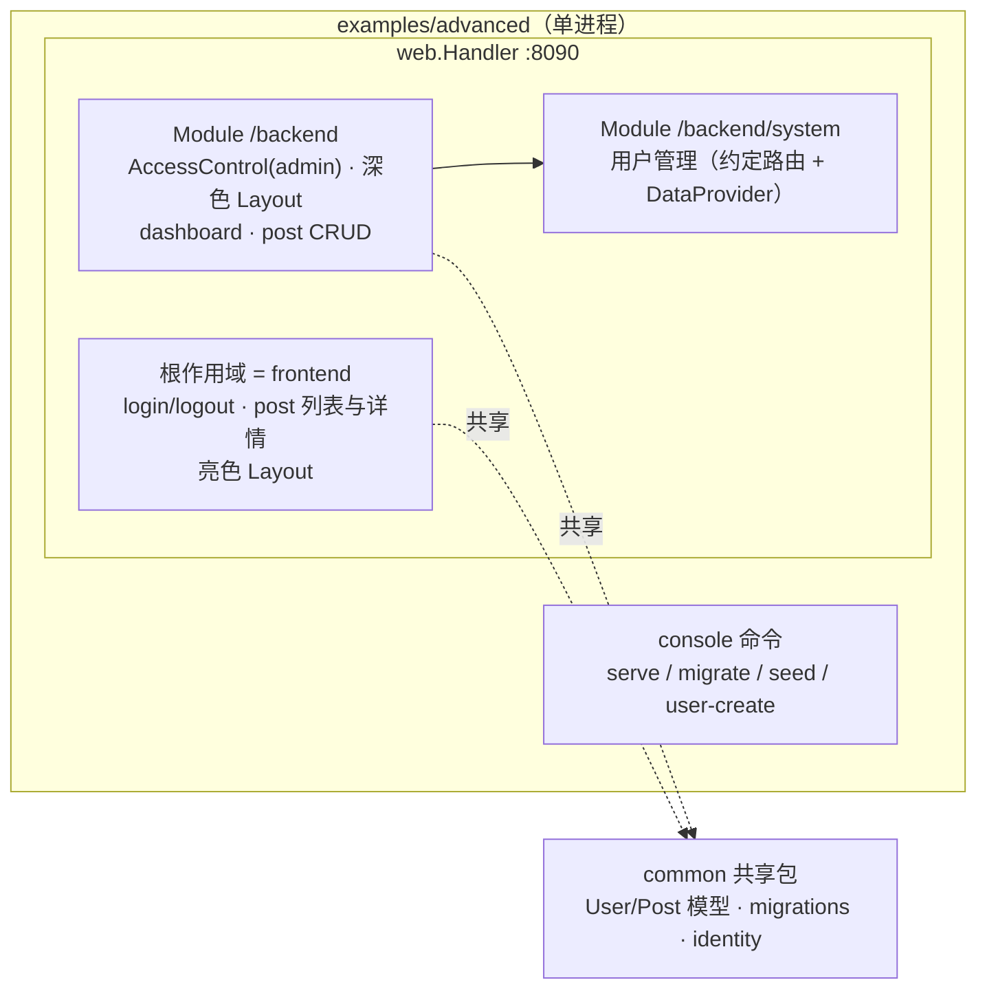

# advanced 示例（Yii2 高级模板形态）规格

来源：`/grill-with-docs` 共识（2026-10-31），工单见 `issues/`。

## 目标

在 `examples/advanced/` 新增对应 Yii2 高级模板（advanced template）的示例应用，重点示范**应用分区 + Module 功能**，与 `examples/basic`（组件全景）互补。

## 共识决策

| # | 决策 | 结论 |
|---|------|------|
| 1 | 位置与组织 | `examples/advanced/`，按 `common/ frontend/ backend/ commands/ config/` 分区，各分区暴露装配函数，main.go 只做组装（保持 ADR-0005 代码装配） |
| 2 | 拓扑 | 单进程单端口：frontend = 根作用域（非模块），backend = `/backend` 模块，console = 同一二进制命令 |
| 3 | 登录与权限 | 单一登录 + RBAC：backend 模块 AccessControl 要求 `admin` 角色（DbManager + seed 授权）；文档注明与 Yii2 前后台独立登录的差异 |
| 4 | 特性范围 | 登录/登出、Post 后台 CRUD + 前台列表/详情、嵌套子模块、双 Layout、migrate/seed、`user/create` 命令、dev/prod overlay（`${VAR}`）、各切片测试；排除 queue、mail、Vite、debug、authclient、i18n、PageCache、behaviors（basic 已覆盖） |
| 5 | 视图 | templ 双 Layout：前台亮色默认布局，后台 `ModuleRoutes.Layout` 深色侧边栏；无 Vite |
| 6 | 嵌套子模块 | `/backend/system` 用户管理：`RegisterController` 约定路由 + DataProvider 分页（与 basic 的 `/admin/report` 显式挂载互补） |
| 7 | 文档 | 新增 `docs/示例-advanced模板.md`（映射关系 + 差异说明），README 快速上手补节 |

## 拓扑

## Yii2 高级模板映射

| Yii2 advanced | goyii advanced 示例 |
|---|---|
| frontend 应用（独立域名） | 根作用域（`app.RegisterController`） |
| backend 应用（独立域名） | `/backend` 模块（含嵌套 `/backend/system`） |
| console 应用（yii 命令） | 同一 main 的 console 命令（migrate/serve/seed/user-create） |
| common/（共享模型与配置） | `common/` 共享 Go 包（模型、迁移、identity） |
| environments/（dev/prod） | `app.yaml` + `web-dev.yaml` / `web-prod.yaml` overlay + `${VAR}` 插值 |
| 前后台独立登录（不同 identity/cookie） | **不复刻**：单一登录 + RBAC admin 角色守卫 backend（差异在文档注明） |
