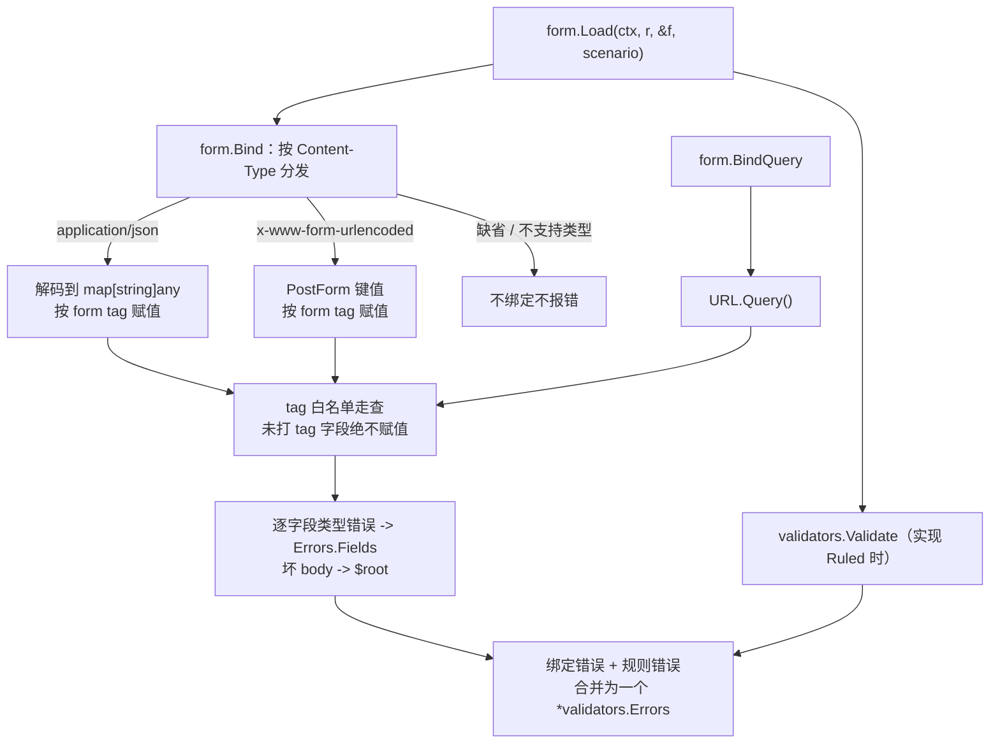

# 引入表单绑定层，不引入 SearchModel（form 包与表单模型）

## 背景

Yii2 的输入侧有两条腿：**FormModel**（继承 `yii\base\Model` 的动态属性容器，`load()` 大规模赋值，`attributes()`/`scenarios()` 在子类里声明字段白名单）与 **SearchModel**（列表过滤的专用模型形态：过滤字段 + `search()` 返回 ActiveDataProvider）。goyii 的模型是强类型 struct + zog 场景校验（ADR-0001 的立场：不复刻 PHP 动态属性机制），输入侧此前是缺口，examples 与 gii 生成物里长出了四套手写样板：

- `readPostForm` / `postFormInput`（全 string 中间层）逐字段读取 HTML 表单，`apply` 拷贝进记录；
- `postPayload`（JSON DTO）镜像一份字段，多一套结构要同步维护；
- 列表过滤 `readPostFilters` 逐键 `Query().Get`，keep 闭包逐字段手抄键名；
- 登录表单裸用 zog schema + `translateIssues` 手工翻译旁路，错误形态与 `validators.Errors` 分叉。

gii 把三件套（`FormInput` + `read{{.Model}}Form` + `apply` + `FormValues`）随生成物繁殖到每个 CRUD。问题因此成形：Yii2 FormModel/SearchModel 的 Go 化做到什么程度——复刻动态 API？引入 SearchModel 大一统？还是补一个更小的机制把四套样板一次收掉？

## 决策

**引入表单绑定层（`form` 包）：带 `form` tag 的普通 struct 即「表单模型」，框架一次完成请求绑定与按场景校验；SearchModel 维持不引入——列表过滤 = filter struct 经表单绑定读取、`Apply` 显式组装。** 裁决共 13 项共识，分六组：

### 1. 表单模型与三层 API，不复刻动态 Model

不复刻 `yii\base\Model` 的动态 API（`attributes()` / `scenarios()` / `load()` 大规模赋值）——struct tag 即字段声明，场景校验复用已有 `validators.Ruled`，无新接口、无新基类。三层 API：

- `form.Bind(r, &f)`：读 body，按 Content-Type 分发 JSON / x-www-form-urlencoded 两源；
- `form.BindQuery(r, &f)`：读 URL query；
- `form.Load(ctx, r, &f, scenario)`：绑定 + 按场景校验一步闭环，返回统一的 `*validators.Errors`（nil = 通过）；`web.Context.LoadForm` 是转发到 form 包的薄委托。

未实现 `Ruled` 的 struct 走 Load 仅绑定——无规则即无可失败。

### 2. 三源统一白名单（安全模型）

**`form` tag 即白名单**：未打 tag 的导出字段绝不赋值，`form:"-"` 显式退出，请求中无对应字段的键静默忽略（`_csrf` 等隐藏字段天然兼容）。三源（JSON body / form body / query）走同一反射赋值核心，白名单语义由结构保证一致——不存在「这个源严、那个源松」。

JSON 源**不把 body 直解进 struct**：先解码到 `map[string]any` 再按 tag 赋值。`encoding/json` 直解的大小写不敏感字段匹配（键 `Untagged` / `untagged` 都能命中同名导出字段）正是直绑模型时 over-posting 的入口，map 中转从机制上堵死：键只有精确命中 tag 才产生赋值。类型错误逐字段归并进 `validators.Errors.Fields`（非整包失败），消息走 i18n 翻译路径；无法解码的 body（截断 JSON、非对象、整包 `null`、尾随垃圾）归并记录级 `$root` 键。

### 3. 类型集与空值语义

v1 类型集：标量全集（string / 各定长整型 / float / bool）、`[]string`、`time.Time`（RFC 3339 线上格式）、`encoding.TextUnmarshaler` 扩展点（自定义类型自带解析）；全部支持类型亦可用指针字段承载（可空列的天然形态）。**multipart 文件上传明确排除**。

**空值 = 未填写**：单个空值（`age=`、JSON `""` / `null`）对非文本字段不赋值不报错——指针字段保持现值，NULL 不翻转为值、值不翻转为 NULL；文本字段取空串。字段可否为空是 `validators` 的裁决，绑定层不越权。Content-Type 边界：缺省或不可解析的 Content-Type = 未声明任何 body 源，不绑定不报错（只路由显式声明了支持类型的 body）；空 body 与 `{}` 同义，是合法空提交。

### 4. 绑定目标形态：直绑为默认，先查再绑防零值覆盖

四套手写样板全部淘汰（`postPayload` / `postFormInput` / `readPostForm` / gii 三件套）。替代形态按场景分两路：

- **登录表单、filter struct 这类「形态本就不同」的输入保留独立 struct**——不是落库记录，独立表单模型是正统形态；
- **落库表单直绑记录**：create 构造零值记录后 `LoadForm(ScenarioInsert)`；update **先查再绑**（fetch -> Load -> Save），未提交字段保留库值，从形态上防住零值覆盖。

直绑的安全前提就是白名单：主键、引用列（`author_id`）、行为字段（`created_at`/`updated_at`）不打 tag，只由服务端代码赋值（作者引用在 Load 之后显式赋值，提交永远携带不上）。JSON 与 HTML 双路径共用同一表单模型——模型上的 `form` tag 即契约。

### 5. 过滤：filter struct + Apply 显式，不引入 SearchModel

SearchModel 大一统（`search()` 返回 provider）不引入。分工固定：**过滤的读取机制归框架，过滤的查询语义留项目**——filter struct 打 `form` tag 经 `form.BindQuery` 读取，`Apply`（字符串列 LIKE+转义、其余列等值）留在项目代码显式组装；`dataprovider.FromRequest` 的分页排序解析维持现状，**并存不合并**——排序白名单属取数层语义，与字段绑定不同层。分页/排序链接保留过滤值的 keep 闭包由 `form.Values(&filters)` 派生，新增过滤字段零改动自动携带，不再逐字段手抄键名。

### 6. 回填与 zog 逃生门

`form.Values(f)` 反射导出 `map[string]string`（按 tag 取键、各类型字符串化，time 按 RFC 3339 保留小数秒，nil 指针渲染空串），供 ActiveForm 的 `Values` 回填，替代手写 map——被拒提交与编辑表单都回显模型当前持有的值。

框架不禁止直接用 zog（逃生门靠能力仍在、不靠许可）——`validators` 的 zog 底座原样可用；但示例不再演示旁路写法：错误形态统一经 `validators.Errors`，翻译统一走其 i18n 路径，消灭第二套错误出口。

## 后果

正面：

- 四套手写样板（JSON DTO / 全 string 中间层 / 逐字段表单读取 / 手写翻译旁路）一次淘汰，gii 生成物同步瘦身；
- over-posting 由机制防住而非纪律防住：白名单走查在三源上是同一份代码，JSON 大小写变体无入口（examples 有越权键全量测试固化）；
- update 先查再绑后，省略字段保留库值——旧「全字段覆写」形态的零值覆盖缺陷从形态上消失（HTML 与 JSON 双路径均有测试证明）；
- 错误形态单轨：解析错误与规则错误同一 `字段 -> []消息` map、同一翻译路径，ActiveForm / 422 JSON 回显零适配；
- 直绑让「模型即契约」成立：字段可编辑性在模型上一眼可读（有 tag 即可提交），不用对照 action 读白名单。

负面 / 代价：

- 绑定是编解码类高风险逻辑，反射走查需 TDD 与高覆盖维持（当前 form 包覆盖率 93%+）；
- `time.Time` 线上格式定为 RFC 3339，HTML `datetime-local` 控件提交的 `YYYY-MM-DDTHH:MM` 不被接受——生成物以 RFC 3339 占位符的 text 输入代替（见再决策）；
- HTML checkbox 无法区分「未勾选」与「省略」，未勾选提交不置 false——需要显式 false 语义的表单得自行加哨兵字段；
- 可空列空提交不再清空为 NULL（旧全 string 中间层的 `""` -> nil 可清空）——「空 = 未填」语义下，置空需求走显式赋值；
- 不支持的 tag 字段类型收到值时 panic（fail-fast），新增字段类型错误在首次提交即炸——这是选择，不是疏漏。

## 落地中的再决策

- **空值语义统一到 JSON 源**：JSON `""` / `null` 对非文本字段同样视为未填写（与表单源 `age=` 对齐）；整包 `null` body 判 malformed JSON 归并 `$root`——Go 的 `json.Decode` 对 `null` -> map 不报错，是显式裁决补的洞；
- **gii 白名单裁决**（05 票先例的 gii 化）：主键、`..._id` 后缀引用列（gii 无可移植 FK 内省，后缀即外键探测）、二进制列、`created_at`/`updated_at` 不打 `form` tag；`_id` 列在 Rules 骨架追加「绑定后服务端补值」TODO 提示；
- **datetime 列渲染**：绑定层日期时间线上格式为 RFC 3339，生成物把 datetime 列渲染为带 RFC 3339 占位符的 text 输入，JSON 与 HTML 双路径可往返；旧 datetime-local 输入不再生成；
- **zog `Required(...)` 陷阱**：zog 原生类型默认可选，零值字段不触发无 Required 前缀的规则链——要在「绑定失败保零值」场景断言规则消息，规则链必须 `Required(z.Message(...))` 前缀（Required 失败短路后续规则，消息顺序稳定）；
- **两处机制小修（随 07 票附带回归测试）**：① form 包补指针字段支持——生成模型的可空列即 `*string`/`*time.Time`，原实现提交非空值会 panic；`nullableTarget` 解引用按需分配 pointee，解析失败回滚保持 NULL。② `view.ActiveForm` checkbox 原以「非空即选中」判定，`form.Values` 的 bool `false` 渲染为非空 `"false"` 会把未勾选框错误回填为选中；改为仅 `"1"` / `"true"` / `"on"` 判选中。

## Considered Options

- **JSON 绑定路径**：解码到 map 中转再按 tag 赋值（**选定**）；`encoding/json` 直解 struct（rejected：大小写不敏感字段匹配让未打 tag 的导出字段可被命中，直绑记录时 over-posting 有入口；`json` tag 与 `form` tag 双契约也使白名单失焦）。
- **列表过滤形态**：filter struct + `BindQuery` 读取 + `Apply` 显式组装（**选定**）；SearchModel 大一统（rejected：`search()` 把「读什么字段」与「怎么组查询」锁进一个框架概念，LIKE/转义/跨列语义仍要项目写，大一统只省了一层 struct 声明却引入第二个模型基类）；action 里继续逐键 `Query().Get`（rejected：无白名单、无类型解析、keep 闭包手抄键名，样板持续繁殖）。
- **写入路径中间层**：直绑记录 + 先查再绑（**选定**）；全 string 中间层 `FormInput` + apply（rejected：每个 action 三段样板、字段三处声明、update 全字段覆写的零值覆盖是结构性缺陷）；JSON DTO `postPayload`（rejected：与 HTML 路径两套字段声明要同步维护，双路径契约分裂）。
- **`yii\base\Model` 动态 API**：struct tag + `validators.Ruled` 组合（**选定**）；复刻 `attributes()`/`scenarios()`/`load()`（rejected：ADR-0001 已裁决不复刻动态属性机制——映射成 Go 需要 `map[string]any` 与反射属性表，牺牲类型安全；场景校验已有 `validators` 场景机制承载，无需第二套）。
- **multipart 文件上传**：v1 排除（**选定**：文件上传属另一个问题域——流式读取、大小限制、MIME 校验、落盘策略，硬塞进字段绑定使两边的语义都变含糊）；纳入（rejected：范围蔓延，需求出现时另行决策）。
