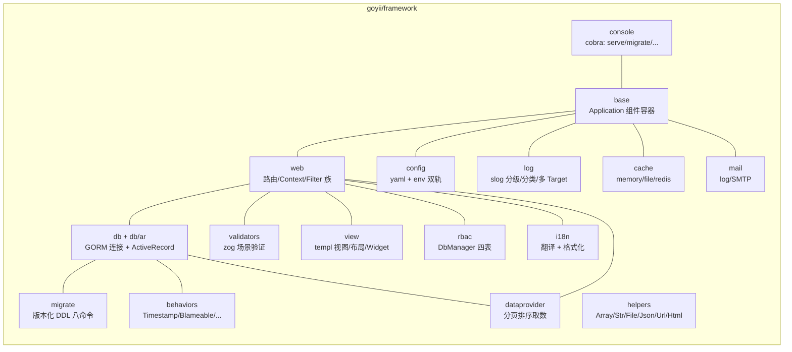

# 安装

goyii 是用 Go 重写 Yii2 的框架：保留 Yii2 的架构概念与心智模型（组件化 Application、ActiveRecord、约定式路由、Filter 族中间件），以 Go 接口、泛型与显式注册落地。本文说明如何获取与准备环境。

## 环境要求

| 项 | 要求 | 说明 |
|---|---|---|
| Go | 1.26+ | module 声明 `go 1.26.0`；本机更新的版本（如 1.27）可直接使用 |
| 数据库 | 无硬依赖 | 示例用 SQLite（纯 Go 驱动，无 CGO）；连接 MySQL/Postgres/SQLServer 时需相应服务 |
| Redis | 可选 | 仅 cache/session 选择 redis 后端时需要 |
| 操作系统 | 任意 Go 支持平台 | Windows / Linux / macOS 均可；SQLite 路径为纯 Go 实现，无平台编译要求 |

### Windows 附加说明（跑 `-race` 测试）

`go test -race` 需要 CGO 与 gcc。Windows 下若 gcc 来自 scoop 的 mingw 且无 shim，按下面方式前缀 PATH：

```bash
PATH="/c/Users/<you>/scoop/apps/mingw/current/bin:$PATH" CGO_ENABLED=1 go test -race ./...
```

不跑竞态测试时无需 CGO，`go test ./...` 即可。

## 获取框架

框架是单一 Go module（module path `github.com/goyii2/framework`）：

```bash
# 克隆仓库（含示例与测试）
git clone https://github.com/goyii2/framework.git
cd framework
go build ./...

# 或在你的项目中作为依赖引入
go get github.com/goyii2/framework
```

依赖网络首次拉取后全部进入本地 module 缓存，之后离线可构建。

## 目录速览



| 包 | 对应 Yii2 命名空间 | 职责 |
|---|---|---|
| `base` | `yii\base` | Application 强类型组件容器、Module 注册表、事件调度 |
| `web` | `yii\web` | Handler/Context/Controller、显式路由 + 约定回退、AccessControl/VerbFilter/Csrf 等中间件、Session/User |
| `url` | `yii\helpers\Url` | 命名路由反向 URL 生成（`url.To`） |
| `db` / `db/ar` | `yii\db` / `yii\db\ActiveRecord` | GORM 连接组件、泛型 ActiveRecord（查询链、Save/Delete、事务、钩子） |
| `migrate` | `yii\console\controllers/MigrateController` | 版本化迁移（yiimigrate 并入，database/sql 直连） |
| `validators` | `yii\validators`（形态） | 场景 -> zog schema 映射，保存链路自动触发 |
| `log` | `yii\log` | slog 分级/分类、console/file Target、profile 计时 |
| `cache` | `yii\cache` | Cache 接口 + memory/file/redis + 依赖失效 |
| `console` | `yii\console` | cobra 根命令 `goyii`：serve、用户命令注册位 |
| `helpers` | `yii\helpers` | Array/Str/File/Json/Url/Html 惯用帮助函数 |
| `view` | `yii\web\View` / `yii\widgets` | templ 视图注册表、Layout 组合、LinkPager/Breadcrumbs/Menu/DetailView |
| `rbac` | `yii\rbac` | DbManager（四表 + item 图缓存）、规则代码定义、与 AccessControl/User 联动 |
| `i18n` | `yii\i18n` | JSON 消息源（embed）、语言协商链、日期/数字/货币 Formatter |
| `dataprovider` | `yii\data` | ActiveDataProvider / ArrayDataProvider，分页排序白名单 |
| `behaviors` | `yii\behaviors` | Timestamp / Blameable / Sluggable / OptimisticLock（内嵌 + Hooks 分发） |
| `mail` | `yii\swiftmailer`（使用面） | Mailer 接口 + log 驱动 + SMTP 驱动 |

## 验证安装

```bash
go build ./...   # 无输出即成功
go vet ./...
```

跑通完整示例与全部测试见 [快速上手](快速上手.md)；一键验收脚本见 `scripts/p0-check.sh`（P0 API 面）与 `scripts/p1-check.sh`（全量 + 浏览器链路面）。

## 下一步

- [快速上手](快速上手.md)：从零跑起 examples/basic（迁移 -> seed -> 登录 -> 浏览器页面 + CRUD API）
- [配置参考](配置参考.md)：全部配置段落、默认值与环境变量
- `examples/basic/`：P0+P1 能力的完整演示应用，可当作项目模板阅读
- `dev-docs/PRD.md` 与 `dev-docs/adr/`：设计决策与架构记录（开发者向）
