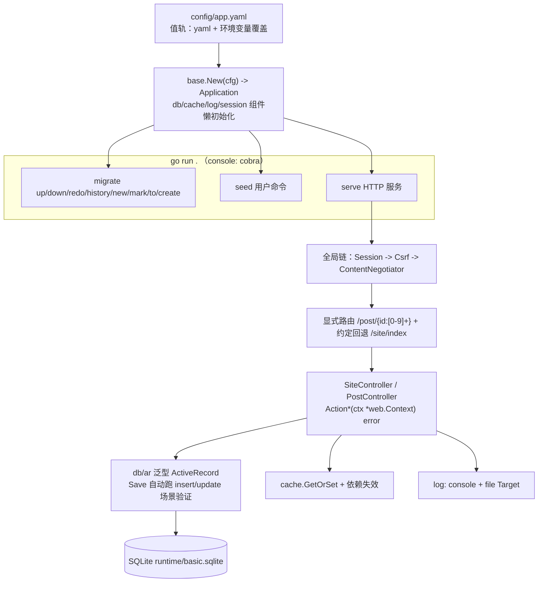

# 快速上手

从零跑起 `examples/basic`——一个覆盖 P0 全链路的最小应用：配置装配 -> 迁移建表 -> seed -> 会话登录 -> 带场景验证的 CRUD（错误协商、AccessControl/VerbFilter/Csrf、日志与缓存全部参与）。全程只需要 Go：数据库用 SQLite 文件，无任何外部服务。

## 1. 从 clone 到跑通

```bash
git clone https://github.com/goyii2/framework.git
cd framework/examples/basic

go run . migrate up   # 建表：user + post（SQLite 文件 runtime/basic.sqlite）
go run . seed         # 演示账号 admin/admin123、demo/demo123 + 一篇示例文章
go run . serve        # 监听 127.0.0.1:8090（web.listen 可配）
```

新开终端验证：

```bash
curl -s http://127.0.0.1:8090/site/index    # 约定路由（无显式绑定）也能应答
```

首次运行会在 `examples/basic/runtime/` 下生成 `basic.sqlite`（数据库）、`app.log`（日志）、`session/`、`cache/`。想重来一遍：删掉 `runtime/` 目录重新执行三步。

`Ctrl+C`（SIGINT/SIGTERM）优雅停机：在途请求完成后进程退出，日志 file target 由框架统一关闭。

## 2. 应用长什么样



关键代码文件（`examples/basic/` 下）：

| 文件 | 内容 |
|---|---|
| `main.go` | 装配：config -> Application -> handler（IdentityFinder、路由）-> console（serve/migrate/seed） |
| `config/app.yaml` | 值配置：SQLite DSN、file 缓存/会话、双 Target 日志、慢查询阈值 |
| `models.go` | `User`（实现 web.Identity + insert 唯一性规则）、`Post`（insert/update 双场景规则） |
| `controllers.go` | 登录/登出/当前用户、CRUD（422 验证错误、403 授权、缓存列表）、VerbFilter 演示 |
| `seed.go` | 用户自定义 console 命令的注册形态 |
| `migrations/` | 两条手写迁移 + `All()` 清单（交给 `goyii migrate`） |

## 3. 走一遍完整链路

登录是 CSRF 双提交模式：先 GET 拿 token（同时种下 `_csrf` cookie），写请求把同一值放进 `X-Csrf-Token` 头。`-c/-b` 维护 cookie jar：

```bash
cd examples/basic
JAR=$(mktemp)   # cookie jar

# 约定回退 + 拿 CSRF token
curl -s -c "$JAR" http://127.0.0.1:8090/site/index
TOKEN=$(curl -s -b "$JAR" -c "$JAR" http://127.0.0.1:8090/site/csrf | sed 's/.*"csrf":"\([^"]*\)".*/\1/')

# 不带 token 的写请求 -> 400（Csrf 中间件生效）
curl -s -o /dev/null -w "%{http_code}\n" -X POST http://127.0.0.1:8090/login \
  -H "Content-Type: application/json" -d '{"username":"admin","password":"admin123"}'

# 错密码 -> 401；正确登录 -> 200，会话 cookie 落进 jar
curl -s -b "$JAR" -c "$JAR" -X POST http://127.0.0.1:8090/login \
  -H "Content-Type: application/json" -H "X-Csrf-Token: $TOKEN" \
  -d '{"username":"admin","password":"wrong"}'
curl -s -b "$JAR" -c "$JAR" -X POST http://127.0.0.1:8090/login \
  -H "Content-Type: application/json" -H "X-Csrf-Token: $TOKEN" \
  -d '{"username":"admin","password":"admin123"}'

curl -s -b "$JAR" http://127.0.0.1:8090/me   # {"guest":false,"name":"admin","roles":["admin"]}
```

CRUD 与验证（写操作需登录 —— AccessControl 规则：读公开、写需 `@`、删需 `admin`）：

```bash
# 验证失败 -> 422 + 字段 -> 消息数组（insert 场景）
curl -s -b "$JAR" -X POST http://127.0.0.1:8090/post \
  -H "Content-Type: application/json" -H "X-Csrf-Token: $TOKEN" \
  -d '{"title":"ab","status":"bogus"}'
# -> {"status":["status must be one of: draft, published"],"title":["title must be at least 3 characters"]}

# 创建 -> 201 + Location（命名路由反向生成）；查看 -> 作者关联预加载
curl -s -D - -o /dev/null -b "$JAR" -X POST http://127.0.0.1:8090/post \
  -H "Content-Type: application/json" -H "X-Csrf-Token: $TOKEN" \
  -d '{"title":"First post","body":"hello","status":"published"}' | grep -i location
curl -s http://127.0.0.1:8090/post/3

# 缓存：新建改变了依赖值 -> 列表重建（MISS），再读命中（HIT）
curl -s -D - -o /dev/null http://127.0.0.1:8090/post | grep -i x-cache   # X-Cache: MISS
curl -s -D - -o /dev/null http://127.0.0.1:8090/post | grep -i x-cache   # X-Cache: HIT

# 错误处理协商：同一 404，格式随 Accept
curl -s http://127.0.0.1:8090/post/999999                          # JSON
curl -s -H "Accept: text/html" http://127.0.0.1:8090/post/999999   # HTML

# 授权：demo 登录后删文章 -> 403；admin -> 204
# 动词：POST /site/index -> 405 + Allow: GET, HEAD（VerbFilter）
# 登出 -> 204，此后 /me 回到 {"guest":true}
curl -s -o /dev/null -w "%{http_code}\n" -b "$JAR" -X POST http://127.0.0.1:8090/logout -H "X-Csrf-Token: $TOKEN"
```

日志与缓存可观察（无需停下应用）：`runtime/app.log` 收全部 `[db]` 查询记录与 `[cache]` 命中/重建事件；示例配置把慢查询阈值调到 1ms，普通查询即以 `slow query` WARN 落盘：

```bash
grep -c "\[db\]" runtime/app.log        # 每条 SQL 一条记录
grep "slow query" runtime/app.log | head -2
grep "\[cache\]" runtime/app.log | head -2
```

## 4. 一键验收

```bash
./scripts/p0-check.sh
```

脚本依次执行：格式检查（gofmt）-> go vet -> 全量测试（含 `-race`）-> 示例编译 -> 起服冒烟（迁移/seed/serve + curl 断言登录、验证、授权、缓存、日志）-> 清理。全部通过即 P0 链路完好。

## 5. 换个数据库 / 改配置

配置值全部可被环境变量覆盖（字段路径大写下划线），不起 yaml 也能切换：

```bash
DB_DSN="/tmp/demo.sqlite" DB_DIALECT=sqlite go run . serve
WEB_LISTEN=":9000" go run . serve
DB_DSN="user:pass@tcp(127.0.0.1:3306)/demo" go run . migrate up   # MySQL（需自备服务）
```

环境选择走 `GOYII_ENV`（默认 dev）：`config/app.yaml` 之上叠加 `config/web-<env>.yaml` 覆盖层。
