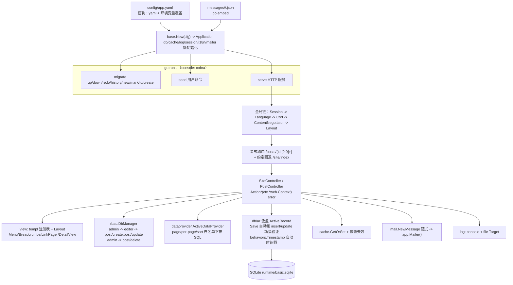

# 快速上手

从零跑起 `examples/basic`——覆盖 P0 到 P2 全链路的完整演示应用：配置装配 -> 迁移建表 -> seed -> 浏览器走通（登录、RBAC 差异化导航、翻译、GridView 分页/过滤/排序列表、详情、ActiveForm 编辑验证、邮件、队列、整页缓存、调试面板）与 JSON API 共存（错误协商、AccessControl/VerbFilter/Csrf、日志与缓存全部参与）。全程只需要 Go：数据库用 SQLite 文件，无任何外部服务（前端产物已随库构建，Node 仅在重新构建前端时需要）。

## 1. 从 clone 到跑通

```bash
git clone https://github.com/goyii2/framework.git
cd framework/examples/basic

go run . migrate up   # 建表：user + post + RBAC 四表 + 队列表 + 时间戳列（SQLite 文件 runtime/basic.sqlite）
go run . seed         # 账号 admin/admin123、editor/editor123、demo/demo123 + RBAC 层级 + 25 篇文章 + 3 个演示队列 Job
go run . serve        # 监听 127.0.0.1:8090（web.listen 可配）
```

浏览器打开 <http://127.0.0.1:8090/>：主页 -> Posts 看列表（分页/排序）-> 登录后按账号看到不同菜单（editor/admin 多出 New post，admin 详情页多出 Delete）-> 右上角语言切换（界面与验证消息都翻译）-> 首页 Send a test email（log 驱动记录到 runtime/app.log 与控制台）。

命令行也能验证：

```bash
curl -s http://127.0.0.1:8090/site/index    # 约定路由（无显式绑定）也能应答
```

首次运行会在 `examples/basic/runtime/` 下生成 `basic.sqlite`（数据库）、`app.log`（日志）、`session/`、`cache/`。想重来一遍：删掉 `runtime/` 目录重新执行三步。

`Ctrl+C`（SIGINT/SIGTERM）优雅停机：在途请求完成后进程退出，日志 file target 由框架统一关闭。

## 2. 应用长什么样



关键代码文件（`examples/basic/` 下）：

| 文件 | 内容 |
|---|---|
| `main.go` | 装配：config -> Application（embed 消息 -> SetI18n）-> handler（debug 面板、Vite 头部与静态资源、IdentityFinder、AuthManager、路由、视图注册）-> console（migrate/seed/queue） |
| `config/app.yaml` | 值配置：SQLite DSN（WAL + busy_timeout）、file 缓存/会话、db 队列、双 Target 日志、慢查询阈值、i18n、log 邮件 |
| `models.go` | `User`（web.Identity + insert 唯一性规则）、`Post`（双场景规则 + Timestamp 行为 + 关联） |
| `controllers.go` | JSON API：登录/登出/当前用户、CRUD（422 验证错误、403 授权、缓存列表）、VerbFilter 演示、嵌套 admin 模块 |
| `pages.go` | 浏览器页面：首页/登录/通知，GridView 列表（排序列 + 过滤行 + LinkPager）、DetailView 详情、ActiveForm 创建/编辑（422 回显）、队列页、PageCache 演示页 |
| `jobs.go` | 队列演示：`EmailJob`（注册名 + JSON 载荷，经 mailer 投递）与队列表状态读取 |
| `views.go` / `views.templ` | 布局与导航（Menu 组件 + 权限菜单 + 语言切换 + Vite 头部）、页面模板（templ generate 生成 `views_templ.go`） |
| `seed.go` | 三账号 + RBAC 层级 + 25 篇文章 + 演示队列 Job；用户自定义 console 命令的注册形态 |
| `migrations/` | 手写迁移 + `rbac.NewMigration()` + `queue.NewMigration()` + `All()` 清单 |
| `messages/zh-CN/app.json` | 中文翻译（界面文案 + 验证消息） |
| `web/` | 最小 Vite 前端工程：`src/main.ts` 入口 + 构建产物（`dist/.vite/manifest.json` 与 hash 资源入库），Go 侧经 `vite.Entry` 引用 |

## 3. 浏览器链路走一遍

账号与权限（seed 建立，RBAC 层级 `admin -> editor -> post/create, post/update`，`admin -> post/delete`）：

| 账号 | 密码 | 菜单/按钮 |
|---|---|---|
| demo | demo123 | 浏览 |
| editor | editor123 | + New post / Edit |
| admin | admin123 | + Delete（经层级继承 editor 全部能力） |

1. 列表 `http://127.0.0.1:8090/posts`：默认新文章在前；GridView 排序列头（`?sort=title`、`?sort=-created_at`——白名单外字段 400）+ 过滤行（标题包含匹配 + 状态下拉）；LinkPager 翻页（`?page=2`），翻页与排序都带着过滤条件。
2. 详情 `/posts/2`：面包屑 + DetailView（标题/状态/作者/创建时间，日期经 i18n 格式化）。
3. 登录 `/login`（editor）：表单带 CSRF 隐藏字段；失败 422/401 回显，成功跳列表。
4. New post：ActiveForm 空标题提交 -> 422 表单回显（字段消息 + 已输入值）；合法提交 -> 302 到新详情。
5. 语言切换：右上角「中文」-> 界面变中文，会话粘住；再提交非法表单 -> 验证消息也是中文（`标题长度至少为 3 个字符`）。
6. admin 登录：详情页出现 Delete 按钮（editor 没有）；删除 -> 跳回列表。
7. 首页 Send a test email：log 驱动把完整消息记入日志——`grep "Subject:" runtime/app.log` 或 serve 控制台。
8. 首页 Vite 按钮：加载前端 bundle 后文字变为「Vite bundle loaded — click me」并计数点击（`web/src/main.ts`）。

## 4. P2 生态走一遍（队列 / 调试面板 / 整页缓存 / 前端）

**队列**（db 驱动，表即 `queue`，与业务库同一个 SQLite 文件；WAL + busy_timeout 让 serve 与 worker 两进程并行）：

```bash
go run . queue run      # 单轮消费（cron 式）：seed 的 3 个演示邮件 Job 在此投递
go run . queue listen   # 或常驻 worker（SIGINT/SIGTERM 优雅退出）
```

浏览器打开 <http://127.0.0.1:8090/queue>：三行计数（waiting/reserved/failed，直读队列表）+ Enqueue a demo email 按钮——按下即入队一个 `EmailJob`，页面回显 `Job #N pushed`；另开终端跑一次 `queue run`，邮件落进 worker 输出与应用日志。Job 定义在 `jobs.go`（`Name() + Execute(ctx)`），在 `main.go` 里 `app.Queue().Jobs().Register(&EmailJob{})` 注册——push 只存「注册名 + JSON 载荷」，任务代码不随队列出进程。

**调试面板**（`app.debug: true` 即生效）：每个页面底部有 toolbar（状态码/耗时/SQL 数/日志数 + detail 链接）；打开 <http://127.0.0.1:8090/debug> 看请求历史，点 detail 看七面板（请求与路由匹配、日志、SQL、时间线、Session/User、配置摘要脱敏、邮件）。记录按请求落 `runtime/debug/*.json`，默认保留 200 条；面板页仅本机可访问。

**整页缓存**：打开 <http://127.0.0.1:8090/pagecache>——页面带渲染时间戳，3 秒生命周期内刷新时间戳纹丝不动（缓存的整页在回放），过期后重新渲染。该页控制器级挂 `web.PageCache{Duration: 3s, VaryBy: ...}`（`pages.go` 的 `CacheController`，按语言 + 登录账号分变体）；与调试面板共存的层级是：采集在外、PageCache 在内——缓存条目永远干净，每次回放都拿到当次请求的新 toolbar。

**嵌套模块**：`/admin/panel/index`（约定路由）与 `/admin/report/dashboard`（显式路由）挂在 admin 模块树下，模块级 AccessControl 要求登录——匿名 403，admin 登录后返回模块信息 JSON（`main.go` 的模块注册段）。

**前端构建**（可选，仅改前端时需要 Node）：`web/` 是最小 Vite 工程，构建产物已入库——Go 侧运行不依赖 Node。重新构建：

```bash
cd web && npm install && npm run build   # 重新生成 dist/（manifest + hash 资源）
```

开发模式（真机 HMR 冒烟需人工）：`npm run dev` 起Vite 开发服务器（:5173），把 `web/dist/.vite/manifest.json` 改名或删掉后重启 Go 应用即切到 dev 模式——页面头指向 `localhost:5173/src/main.ts` 并注入 `@vite/client`，`/assets` 经 `vite.DevProxy` 反向代理回开发服务器（含 WebSocket 透传）。

## 5. JSON API 走一遍

登录是 CSRF 双提交模式：先 GET 拿 token（同时种下 `_csrf` cookie），写请求把同一值放进 `X-Csrf-Token` 头。`-c/-b` 维护 cookie jar：

```bash
cd examples/basic
JAR=$(mktemp)   # cookie jar

# 约定回退 + 拿 CSRF token
curl -s -c "$JAR" http://127.0.0.1:8090/site/index
TOKEN=$(curl -s -b "$JAR" -c "$JAR" http://127.0.0.1:8090/site/csrf | sed 's/.*"csrf":"\([^"]*\)".*/\1/')

# 不带 token 的写请求 -> 400（Csrf 中间件生效）
curl -s -o /dev/null -w "%{http_code}\n" -X POST http://127.0.0.1:8090/login \
  -H "Content-Type: application/json" -d '{"username":"admin","password":"admin123"}'

# 错密码 -> 401；正确登录 -> 200，会话 cookie 落进 jar
curl -s -b "$JAR" -c "$JAR" -X POST http://127.0.0.1:8090/login \
  -H "Content-Type: application/json" -H "X-Csrf-Token: $TOKEN" \
  -d '{"username":"admin","password":"wrong"}'
curl -s -b "$JAR" -c "$JAR" -X POST http://127.0.0.1:8090/login \
  -H "Content-Type: application/json" -H "X-Csrf-Token: $TOKEN" \
  -d '{"username":"admin","password":"admin123"}'

curl -s -b "$JAR" http://127.0.0.1:8090/me   # {"guest":false,"name":"admin","roles":["admin"]}
```

CRUD 与验证（AccessControl 规则：读公开、写需 `@`、删需 `post/delete` 权限）：

```bash
# 验证失败 -> 422 + 字段 -> 消息数组（insert 场景）
curl -s -b "$JAR" -X POST http://127.0.0.1:8090/post \
  -H "Content-Type: application/json" -H "X-Csrf-Token: $TOKEN" \
  -d '{"title":"ab","status":"bogus"}'
# -> {"status":["status must be one of: draft, published"],"title":["title must be at least 3 characters"]}

# 创建 -> 201 + Location（命名路由反向生成）；查看 -> 作者关联预加载
curl -s -D - -o /dev/null -b "$JAR" -X POST http://127.0.0.1:8090/post \
  -H "Content-Type: application/json" -H "X-Csrf-Token: $TOKEN" \
  -d '{"title":"First post","body":"hello","status":"published"}' | grep -i location
# -> Location: /post/26（seed 25 篇之后的第一篇）

# 缓存：新建改变了依赖值 -> 列表重建（MISS），再读命中（HIT）
curl -s -D - -o /dev/null http://127.0.0.1:8090/post | grep -i x-cache   # X-Cache: MISS
curl -s -D - -o /dev/null http://127.0.0.1:8090/post | grep -i x-cache   # X-Cache: HIT

# 错误处理协商：同一 404，格式随 Accept
curl -s http://127.0.0.1:8090/post/999999                          # JSON
curl -s -H "Accept: text/html" http://127.0.0.1:8090/post/999999   # HTML（注册表错误页）

# 授权：demo 登录后删文章 -> 403；admin -> 204（RBAC 层级间接授权）
# 动词：POST /site/index -> 405 + Allow: GET, HEAD（VerbFilter）
# 登出 -> 204，此后 /me 回到 {"guest":true}
curl -s -o /dev/null -w "%{http_code}\n" -b "$JAR" -X POST http://127.0.0.1:8090/logout -H "X-Csrf-Token: $TOKEN"
```

日志与缓存可观察（无需停下应用）：`runtime/app.log` 收全部 `[db]` 查询记录与 `[cache]` 命中/重建事件；示例配置把慢查询阈值调到 1ms，普通查询即以 `slow query` WARN 落盘：

```bash
grep -c "\[db\]" runtime/app.log        # 每条 SQL 一条记录
grep "slow query" runtime/app.log | head -2
grep "\[cache\]" runtime/app.log | head -2
```

## 6. 一键验收

```bash
./scripts/p2-check.sh   # 全量：gofmt + go vet + go test -race ./... + 前端产物核对 + P2 组件面冒烟
./scripts/p1-check.sh   # P1 页面与组件面：浏览器链路冒烟（登录/GridView/ActiveForm/RBAC/i18n/邮件/API 共存）
./scripts/p0-check.sh   # P0 API 面冒烟（登录/验证/授权/缓存/日志）
```

`p2-check.sh` 依次执行：格式检查（gofmt）-> go vet -> 全量测试（含 `-race`）-> 示例编译 -> Vite 构建产物核对 -> 队列 worker 单轮消费 -> 起服冒烟——页面 head 引用 hash 资源、debug 面板（toolbar/历史/详情）、GridView 过滤行/排序/分页、ActiveForm 422 回显、嵌套模块守卫（匿名 403 / admin 200）、PageCache 命中回放与过期重建、队列页入队 + 并发 worker 消费。全部通过即 P0 到 P2 链路完好。

## 7. 换个数据库 / 改配置

配置值全部可被环境变量覆盖（字段路径大写下划线），不起 yaml 也能切换：

```bash
DB_DSN="/tmp/demo.sqlite" DB_DRIVER=sqlite go run . serve
WEB_LISTEN=":9000" go run . serve
DB_DSN="user:pass@tcp(127.0.0.1:3306)/demo" DB_DRIVER=mysql go run . migrate up   # MySQL（需自备服务）
MAIL_DRIVER=smtp MAIL_SMTP_HOST=smtp.example.com MAIL_SMTP_USERNAME=alerts MAIL_SMTP_PASSWORD=s3cret go run . serve
```

全部段落与字段见 [配置参考](配置参考.md)。环境选择走 `GOYII_ENV`（默认 dev）：`config/app.yaml` 之上叠加 `config/web-<env>.yaml` 覆盖层。
