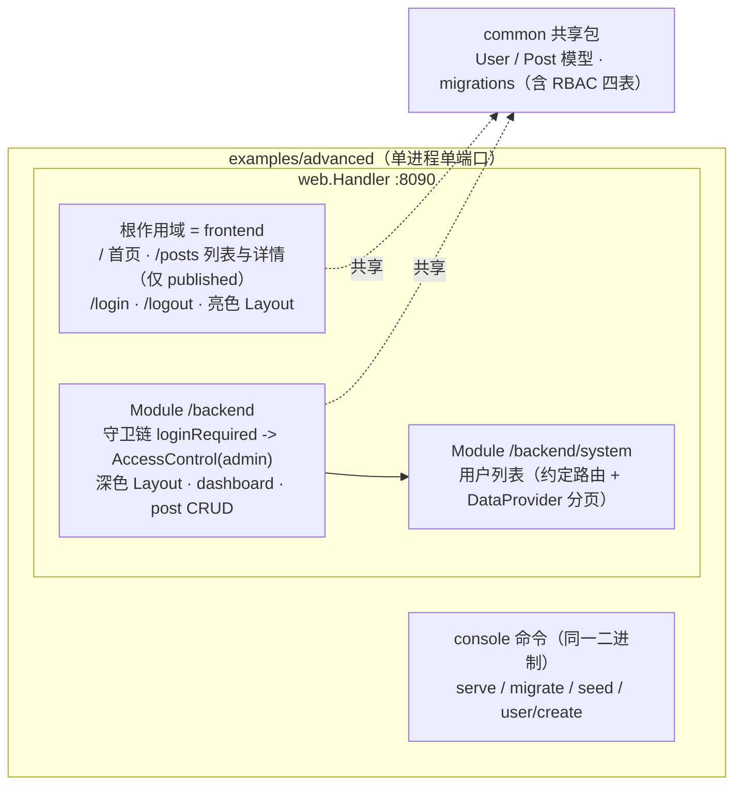

# 示例：advanced 模板

`examples/advanced` 是 Yii2 高级模板（advanced template）在 goyii 上的对应形态：**单进程、单端口**，按 `frontend / backend / common / commands` + `config` 分区，重点示范**应用分区装配 + Module**（含嵌套子模块、模块级守卫链、双 Layout）。与 [examples/basic](快速上手.md)（组件全景：队列、邮件、Vite、调试面板、i18n、PageCache、behaviors）互补——advanced 刻意排除这些，只讲模板形态本身。全程只需 Go：数据库是 SQLite 文件，无外部服务。

## 1. 从 clone 到跑通

```bash
git clone https://github.com/goyii2/framework.git
cd framework/examples/advanced

go run . migrate up   # 建表：user + RBAC 四表（auth_item / auth_assignment ...）+ post
go run . seed         # 账号 admin/admin123、demo/demo123 + admin 角色授予 + 3 篇文章（2 published + 1 draft）
go run . serve        # 单端口 127.0.0.1:8090：frontend 根作用域 + /backend 模块
```

访问入口（一个端口，两个分区）：

| 入口 | 分区 | 内容 |
|---|---|---|
| <http://127.0.0.1:8090/> | frontend（根作用域） | 首页（显示当前环境与登录态）、`/posts` 列表与详情（仅 published）、`/login`、`/logout` |
| <http://127.0.0.1:8090/backend/> | backend（`/backend` 模块） | 深色 Layout：dashboard、post CRUD |
| <http://127.0.0.1:8090/backend/system/user/list> | backend/system（嵌套子模块） | 用户列表：约定路由 + DataProvider 分页 |

种子账号就是后台守卫的三态演示：**admin** 持有 `admin` 角色（seed 授予）进得去后台；**demo** 是无角色的普通登录者，访问 `/backend` 得到 403；匿名访问被重定向到 `/login`。

```bash
go run . user/create --username demo2 --password demo123   # 建号命令（Yii2 的 user/create 对应物）；新账号同样无角色
```

首次运行在 `examples/advanced/runtime/` 下生成 `advanced.sqlite`（WAL 模式，serve 与再次 migrate 可并行）与 `session/`（file 会话）。想重来一遍：删掉 `runtime/` 目录重新执行三步。`Ctrl-C` 优雅停机。

## 2. 目录结构与分区装配

| 目录 / 文件 | Yii2 advanced 对应物 | 内容与装配形态 |
|---|---|---|
| `main.go` | 入口脚本 | 只做组装：加载配置 -> 构造组件 -> 依次调各分区 `Register` -> console 命令树 |
| `config/` | `environments/` | 项目自定义 `Config` struct + `app.yaml` + `web-dev.yaml` / `web-prod.yaml`；三台机器（环境选择 / overlay / 整字段 env 覆盖）见[第 7 节](#7-dev--prod-overlay-与-var-插值) |
| `common/` | `common/` | 共享包：`models/`（User、Post）+ `migrations/`（user 表、RBAC 四表、post 表）；前后台 import 同一个包，共享的不止模型——会话身份解析（`models.FindIdentity`）也是它 |
| `frontend/` | frontend 应用 | 根作用域分区：`controllers/` + `views/`（亮色 Layout）；`frontend.Register(h, app)` 装配显式路由 + 控制器注册表 |
| `backend/` | backend 应用 | `/backend` 模块分区：`controllers/` + `views/`（深色 Layout）+ `system/`（嵌套子模块）；`backend.Register(h, app, auth, cfg.Web.BackendHostInfo)` 建模块、守卫链、dashboard、post CRUD（编辑页 Permalink 用后台自有域名），末尾挂 system 子模块 |
| `commands/` | console 控制器 | cobra 命令（`user/create`、`seed`），与 serve / migrate 同一二进制、同一套装配 |
| `runtime/` | 运行时产物 | `advanced.sqlite` + `session/`（git 忽略，删掉即可重置演示） |

装配原则：**每个分区暴露自己的装配函数，`main.go` 只做组装**——配置值来自 `config/`，行为全部在装配代码里（不用数组配置实例化组件）。两个分区有装配顺序约束：frontend 必须先注册，因为 backend 守卫按命名路由 `site/login` 解析登录页地址，反序注册会在启动期直接报错而不是重定向到幽灵路径。

## 3. 拓扑



backend 模块的守卫链（外层在前）对整棵子树生效，嵌套的 system 子模块不再有自己的守卫：

```
loginRequired(302 -> /login)  ->  AccessControl(roles == ["admin"])
```

## 4. Yii2 高级模板映射表

| Yii2 advanced | goyii advanced 示例 | 说明 |
|---|---|---|
| frontend 应用（独立域名） | **根作用域**（非模块）：`h.Ctrl` 显式路由 + `app.RegisterController` 约定回退 | 直接挂在 handler 根上；`/site/{action}`、`/post/{action}` 也能应答 |
| backend 应用（独立域名） | **`/backend` 模块**：`base.NewModule(app, "/backend")` + `h.Module(prefix)` | 模块级中间件守卫前缀下全部路由；`/backend/system` 再嵌套一层（前缀恰好多一段） |
| console 应用（`yii` 命令行） | **同一 main 的 console 命令**：serve / migrate / seed / user/create | `console.New(app, WithHandler, WithListen)`；用户命令在 `commands/` 包注册 |
| `common/`（共享模型与配置） | **`common/` 共享 Go 包**：models + migrations | 迁移列表 = user 表 + `rbac.NewMigration()` + post 表，两个分区同一套 |
| `environments/`（dev/prod 目录 + init 拷贝脚本） | **`config/` overlay**：`app.yaml` + `web-dev.yaml` / `web-prod.yaml` + `${VAR}` 插值 | 没有 init 脚本：运行时按 `GOYII_ENV` 叠加，不复制文件 |
| 前后台独立登录（各自 identity / cookie） | **不复刻**：单一登录 + RBAC `admin` 角色守卫 backend | 见下一节 |

## 5. 差异：独立登录 -> 单一登录 + RBAC（及其理由）

Yii2 高级模板里 frontend 与 backend 是两个独立应用：各配 `user` 组件与 `identityClass`、各自的会话 cookie 域，前后台登录态互不相认。本示例**不复刻**这一形态：

- **一个进程一个会话**：登录只有 frontend 的 `/login` 一处；会话身份经 `models.FindIdentity` 解析（common 分区），前后台读到同一个登录态。
- **后台靠角色而非第二套登录**：`/backend` 的守卫链要求 `admin` 角色，判定走 RBAC `DbManager`（`auth_item` / `auth_assignment` 等四表）。
- **授权唯一真源是 RBAC 分配表**：`user` 表没有 role 列——角色是授权表里的一行分配（seed 是演示中唯一授予点：admin 得到 `admin`，demo 什么都没有）。授予与回收是数据变更，不动 schema、不改代码；多角色、角色层级、权限继承都装得下（见[组件：rbac](组件-rbac.md)）。
- **与框架能力对齐**：`web.AccessControl` 的 `Roles` 规则本来就经 `AuthManager` 判定，独立登录反而要在模块里再造一套身份组件。

`/backend` 的三态（守卫链外层重定向、内层查角色）：

| 请求者 | 结果 |
|---|---|
| 匿名 | 302 -> `/login`（重定向读作「请先登录」，比裸 403 语义准确） |
| demo（已登录，无角色） | 403 |
| admin（`admin` 角色） | 200，进入深色后台 |

细节：裸前缀 `/backend` 是 302 到规范地址 `/backend/`（模块注册器挂不到裸前缀），守卫在下一跳 `/backend/` 生效。

## 6. 前台 / 后台走一遍

**前台（亮色 Layout，匿名可达）**

1. `/` 首页：显示应用名、环境状态行（`env: dev`，dev 下还多一行 `debug on`——overlay 的可观察差异，见下节）与登录态。
2. `/posts`：仅 `status == published` 的文章，新在前，卡片带摘要/作者/日期；`/posts/{id}` 详情页——**草稿与未知 id 一律 404**（公开侧只解析 published 行）。
3. `/login`：表单带 CSRF 隐藏字段；空字段 422、错误凭据 401（同一句 `Wrong username or password.`，不泄露是哪半错）并回填用户名；成功 302 回首页。`/logout` POST 销毁会话。

**后台（深色 Layout，仅 admin）**

1. `/backend/`：dashboard。
2. `/backend/posts`：**全部**文章（含草稿）最新在前；published 行带 "View site" 跨分区链接（按命名路由 `post/view` 反向生成，指向前台详情页）。
3. New / Edit：ActiveForm（title 必填且 <= 200、status 下拉 draft/published、body <= 10000）；非法提交 422 逐字段回显并回填；成功 302 回列表。Delete 是行内 POST 按钮，删除后 302 回列表。
4. `/backend/system/user/list`：用户列表——**约定路由**（无任何显式声明，`/backend/system/<controller>/<action>` 兜底解析；basic 示例的 `/admin/report` 是显式挂载的对照面）。DataProvider 下推 SQL 分页排序：默认每页 10 条（`?per-page=` 可调），`?page=2` 翻页（LinkPager 渲染翻页条，地址按同一约定反向拼装），`?sort=-username` 排序（白名单 `id` / `username`，白名单外字段 400）。
5. 子模块没有自己的 Layout 绑定：约定路由不经过模块注册器，模块级 `Layout()` 够不到它，所以 `UserController` 以**控制器级 Middleware** 携带后台深色外壳（`backend/system/system.go`）。

## 7. dev / prod overlay 与 `${VAR}` 插值

配置三台机器（详见[配置参考](配置参考.md)）：`GOYII_ENV` 选环境 -> `app.yaml` 之上叠加 `web-<env>.yaml`（只覆盖点名字段）-> 整字段环境变量最后压过（`WEB_LISTEN`、`APP_DEBUG`、...）。本示例的 overlay 文件：

| `GOYII_ENV` | 读取 | 可观察差异 |
|---|---|---|
| `dev`（默认） | `app.yaml` + `web-dev.yaml` | `debug: true`：首页状态行 `env: dev` + `debug on`；真实 500 的错误页展示错误原因 |
| `prod` | `app.yaml` + `web-prod.yaml` | `debug: false`：首页只剩 `env: prod`（debug 行不渲染）；`listen` 与日志级别经 `${VAR}` 插值 |
| 其他（如 `staging`） | 仅 `app.yaml` | 无 overlay 文件即基值 |

`web-prod.yaml` 的生产值用 compose 风格插值（yaml 解析**之前**对整个文件字节展开）：

```yaml
web:
  listen: "${ADVANCED_LISTEN:-127.0.0.1:8090}"   # 未设置或为空 -> 取默认值
log:
  level: "${ADVANCED_LOG_LEVEL:-warn}"
```

`${VAR:-默认}` 让 `GOYII_ENV=prod go run . serve` 开箱即跑；部署时设变量而不是改 yaml。语法还有 `${VAR}`（未设置展开为空串）与「冒号问号」形态（必填值，缺失即装载失败）——插值作用于文件**任何位置**，注释里的占位符同样会被展开，所以 yaml 注释里别写字面的必填形态。整字段覆盖仍然最后生效：`WEB_LISTEN` 压过插值拼出的值。

验证方式（对照首页状态行与监听地址）：

```bash
cd examples/advanced

GOYII_ENV=prod go run . serve                                  # 监听 127.0.0.1:8090（插值默认值）；首页状态行只剩 env: prod
ADVANCED_LISTEN="127.0.0.1:9090" GOYII_ENV=prod go run . serve # 监听地址换到 9090，8090 不再应答
go run . serve                                                 # 不带 GOYII_ENV 即 dev：首页多出 debug on
```

debug 的另一处差异在真实 500：控制器返回的非 HTTP 错误，dev 的错误页带错误原因，prod 只给 `Internal Server Error`（HTTP 错误如 404 两种环境都带自身消息）。

## 8. 与 examples/basic 怎么选

| | examples/basic | examples/advanced |
|---|---|---|
| 定位 | 组件全景（P0-P2 全链路演示） | 应用分区 + Module 模板形态 |
| 覆盖 | queue、mail、Vite、debug 面板、i18n、PageCache、behaviors、GridView/ListView、authclient | 分区装配、模块守卫链、嵌套子模块、双 Layout、dev/prod overlay、DataProvider 分页、ActiveForm CRUD |
| 模块路由 | `/admin/report` 显式挂载 | `/backend/system` 纯约定回退（互补对照） |
| 依赖 | 仅 Go（SQLite） | 仅 Go（SQLite） |

两个示例都是单进程 SQLite 零依赖；想看某个组件的完整用法去 basic，想看多个应用分区如何在单进程单端口上组装看 advanced。

## 9. 测试

每个切片自带测试：`frontend/`（含 post 链路）、`backend/`（守卫三态、CRUD、system 分页）、`commands/`（seed 幂等、user/create 校验）、`config/`（overlay 与插值行为）——

```bash
go test ./examples/advanced/...
```

## 相关文档

- [快速上手](快速上手.md)——examples/basic 全链路
- [配置参考](配置参考.md)——三台机器、`${VAR}` 插值语法全表
- [组件：web 路由与中间件](组件-web路由与中间件.md)——Module、AccessControl、约定回退
- [组件：rbac](组件-rbac.md)——DbManager 分配与判定
- [组件：view 与 templ](组件-view与templ.md)——Layout 组合与控制器级 Layout 中间件
