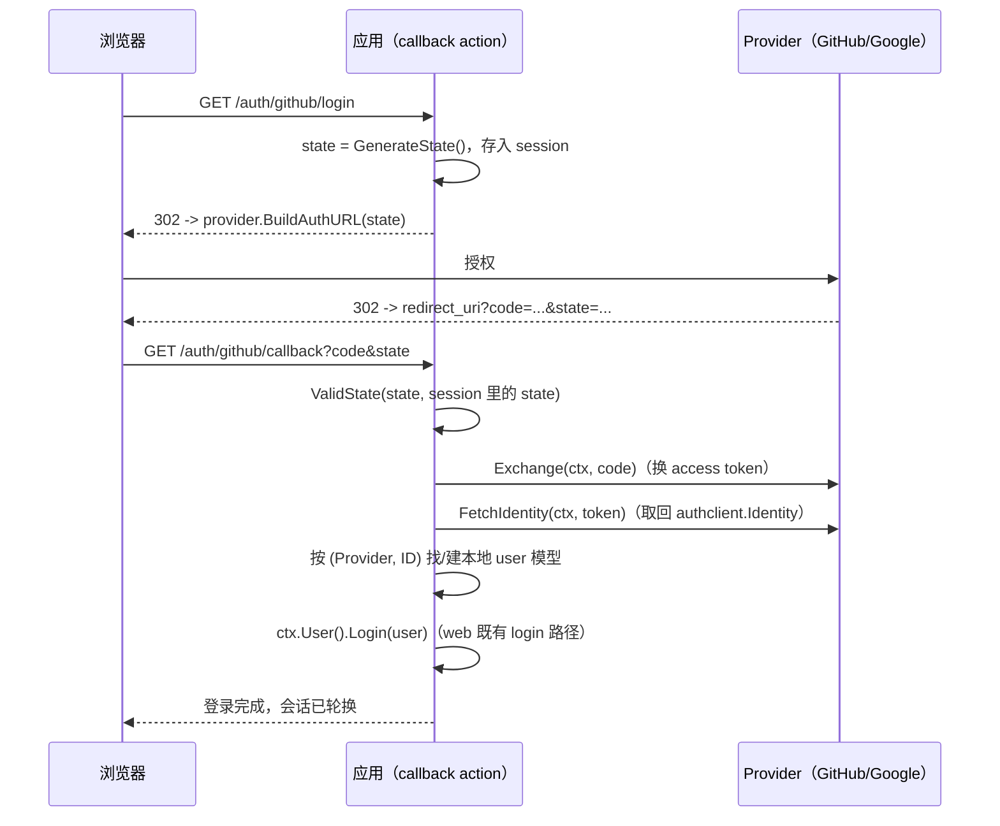

# 组件：authclient 第三方登录

`authclient` 包在 `golang.org/x/oauth2` 之上做薄封装，对应 Yii2 的 `yii\authclient`：一个 Provider 接口覆盖授权跳转流的全部三步（构造授权 URL -> code 换 token -> 取回身份），内置 GitHub 与 Google 两个实现。

刻意不做的：账号关联策略、「第三方身份 -> 本地用户」的映射——那是应用策略，包只交回 `authclient.Identity`（provider 侧身份：内部 ID、显示名、邮箱、原始 payload），登录走 web 既有的 `User.Login` 路径。本包不进 examples 主线（避免外部凭据依赖），联调凭据由应用自己注入。

## 联动路径（先看全景）

第三方登录与既有登录共用同一条会话登录通道：



判定式：`ValidState(回传 state, 会话 state) && code != ""` 才继续；任何一步失败都回到登录页，code 只用一次。

## 配置 provider

GitHub 与 Google 零值即公共端点，必填只有凭据三件套（`RedirectURL` 必须与 provider 应用设置里登记的回调地址完全一致）：

```go
import (
    "golang.org/x/oauth2"
    "github.com/goyii2/framework/authclient"
)

github := &authclient.GitHub{
    Config: oauth2.Config{
        ClientID:     os.Getenv("GITHUB_CLIENT_ID"),
        ClientSecret: os.Getenv("GITHUB_CLIENT_SECRET"),
        RedirectURL:  "https://app.example.com/auth/github/callback",
        // Scopes 不填默认 user:email；Endpoint 不填默认 github.com
    },
}

google := &authclient.Google{
    Config: oauth2.Config{
        ClientID:     os.Getenv("GOOGLE_CLIENT_ID"),
        ClientSecret: os.Getenv("GOOGLE_CLIENT_SECRET"),
        RedirectURL:  "https://app.example.com/auth/google/callback",
        // Scopes 不填默认 openid email profile；Endpoint 不填默认 accounts.google.com
    },
}

// 多 provider 装一张表，回调按路径里的 provider 名取
providers := map[string]authclient.Provider{"github": github, "google": google}
```

两家差异都消化在实现内：GitHub 的 token 请求带 `Accept: application/json`（否则 GitHub 答表单编码），userinfo 调用经 Authorization 头携带 access token（绝不走 URL 参数）；Google 固定 `AuthStyleInParams`（省掉 x/oauth2 的探测请求），身份 ID 用 `sub` 声明，GitHub 用数字 `id`。GitHub Enterprise 自建部署覆盖 `Config.Endpoint` 与 `UserURL` 即可。

## 授权跳转 action

```go
type AuthController struct {
    web.Controller
    Providers map[string]authclient.Provider // github / google
}

func (c *AuthController) ActionLogin(ctx *web.Context) error {
    p := c.Providers[ctx.Param("provider")]
    if p == nil {
        return web.NotFound("unknown provider")
    }

    // 防 CSRF：随机 state 存 session（存取是应用层的事，包不碰 session 内部）
    state := authclient.GenerateState()
    ctx.Session().Set("oauth_state", state)
    ctx.Session().Set("oauth_provider", p.Name())

    return ctx.Redirect(http.StatusFound, p.BuildAuthURL(state))
}
```

## 回调 action（完整最小代码）

```go
func (c *AuthController) ActionCallback(ctx *web.Context) error {
    p := c.Providers[ctx.Param("provider")]

    // state 校验：与会话里存的原值比对（常数时间），一次性消费
    session := ctx.Session()
    expected := session.GetString("oauth_state")
    session.Remove("oauth_state")
    if !authclient.ValidState(ctx.Request().URL.Query().Get("state"), expected) {
        return ctx.Redirect(http.StatusFound, "/login?error=state")
    }

    code := ctx.Request().URL.Query().Get("code")
    if code == "" {
        return ctx.Redirect(http.StatusFound, "/login?error=denied")
    }

    // 换 token，取回 provider 侧身份
    token, err := p.Exchange(ctx.Context(), code)
    if err != nil {
        return ctx.Redirect(http.StatusFound, "/login?error=exchange")
    }
    identity, err := p.FetchIdentity(ctx.Context(), token)
    if err != nil {
        return ctx.Redirect(http.StatusFound, "/login?error=identity")
    }

    // 应用策略：按 (Provider, ID) 找/建本地账号，映射为自己的 user 模型
    user, err := findOrCreateUser(ctx.Context(), identity)
    if err != nil {
        return err
    }

    // web 既有 login 路径：绑定会话 + 轮换 id（防会话固定）
    if err := ctx.User().Login(user); err != nil {
        return err
    }
    return ctx.Redirect(http.StatusFound, "/")
}
```

注册路由（回调地址即 provider 应用设置里登记的 `RedirectURL`）：

```go
r := app.Router()
r.Get("/auth/{provider}/login", authCtrl.ActionLogin).Name("auth/login")
r.Get("/auth/{provider}/callback", authCtrl.ActionCallback).Name("auth/callback")
```

## 身份映射（应用层）

`authclient.Identity` 的字段：`Provider`（"github"/"google"）、`ID`（provider 内部稳定 ID：GitHub 数字 id、Google sub）、`Name`、`Email`（可能为空，取决于授权范围）、`Raw`（userinfo 原始 JSON，头像、主页等自行取用）。账号关联表以 `(Provider, ID)` 复合键：

```go
// 第三方账号绑定表：一个本地用户可绑多个 provider
type OAuthAccount struct {
    ID          int64  `gorm:"primaryKey"`
    UserID      int64
    Provider    string // identity.Provider
    ProviderUID string // identity.ID
}

func findOrCreateUser(ctx context.Context, identity *authclient.Identity) (*User, error) {
    account, err := ar.New[OAuthAccount](ctx).
        Where("provider = ? AND provider_uid = ?", identity.Provider, identity.ID).
        One()
    switch {
    case err == nil:
        return ar.FindByID[User](ctx, account.UserID) // 已绑定：直接登录
    case errors.Is(err, gorm.ErrRecordNotFound):
        // 首次登录：建本地用户 + 绑定行；邮箱冲突时也可改为提示合并
        user := ar.New[User](ctx).New()
        user.Username, user.Email = identity.Name, identity.Email
        if err := user.Save(); err != nil {
            return nil, err
        }
        bind := ar.New[OAuthAccount](ctx).New()
        bind.UserID, bind.Provider, bind.ProviderUID = user.ID, identity.Provider, identity.ID
        if err := bind.Save(); err != nil {
            return nil, err
        }
        return user, nil
    default:
        return nil, err
    }
}
```

`User` 实现 `web.Identity`（见 [组件：session 与认证](组件-session与认证.md)），`Login` 之后的会话、访问控制、RBAC、登出全部复用既有机制——第三方登录没有第二条登录通道。

## 错误与测试

- `Exchange` 失败的错误包裹了 `*oauth2.RetrieveError`，`errors.As` 可取回 provider 的 HTTP 状态与原始错误体；所有错误信息带 `authclient: github:` / `authclient: google:` 前缀可判别来源。
- `FetchIdentity` 对非 2xx userinfo 应答、损坏 JSON、缺稳定 ID（GitHub 无 `id`、Google 无 `sub`）均报错。
- 包内单测用 `httptest` 起 mock OAuth server（authorize/token/userinfo 三端点）覆盖两家的全流程与错误路径；应用自己的联调用真实凭据 + provider 的测试应用，不依赖框架侧凭据。

## 相关文档

- [组件：session 与认证](组件-session与认证.md)（`web.Identity`、`User.Login`、Csrf 边界）
- [组件：rbac](组件-rbac.md)（登录后的 `user.Can` 判定）
