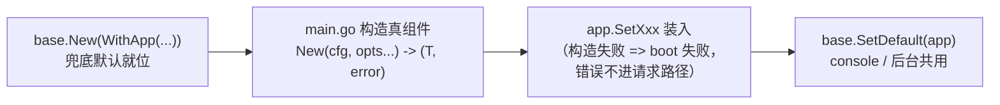

# 组件：base 与 config

`base` 是框架的应用层：强类型组件容器 `Application`、Module 注册表、事件调度。`config` 是纯叶子装载工具（`LoadAs[T]` + `Env()`）：配置结构体归项目所有，三台机器（yaml + overlay + 环境变量覆盖）见 [配置参考](配置参考.md)。

## Application：强类型组件容器

对应 Yii2 的 `yii\base\Application`，但不做运行时服务定位——组件是强类型字段，经零错误方法访问。`base.New` 不收配置，只收身份：

```go
app := base.New(base.WithApp(cfg.App.Name, goyii.Env(), cfg.App.Debug))
```

- `WithApp(name, env, debug)` 三件套：name 进布局与日志上下文、debug 开详细错误页与调试面板、env 是环境名（通常 `config.Env()`）；name / env 空值回落 `myapp` / `dev`。
- web 错误页与调试面板读 `app.Debug()` / `app.Name()`——身份就是给它们用的。

### 全急切装配

`base.New` 立即装好全部兜底默认（见下表）；真组件由 main.go 从项目配置逐个构造、处理错误后 `SetXxx` 替换。构造器只校验、不做网络 IO（go-redis / gorm 懒拨号），急切装配不拖慢 boot：



```go
// examples/basic/main.go 的装配序列（节选）
logger, err := log.New(cfg.Log)
if err != nil { fail(err) }
app.SetLog(logger)

if err := app.ConnectDB(cfg.DB, cfg.Log.Gorm); err != nil { fail(err) } // db 无兜底

cacheC, err := cache.New(cfg.Cache)
if err != nil { fail(err) }
app.SetCache(cacheC)

queueQ, err := queue.New(cfg.Queue, queue.WithDB(app.DB()), app.QueueDispatcher())
if err != nil { fail(err) }
app.SetQueue(queueQ)

sess, err := session.New(cfg.Session)
if err != nil { fail(err) }
app.SetSession(sess)

base.SetDefault(app) // 无请求上下文的代码（console/后台）经 FromContext 解析到它
app.SetI18n(i18n.NewMessageSource(messages, i18n.WithDefaultLanguage(cfg.I18n.Language)))
```

### 访问器与默认清单

访问器全部零错误（请求代码没有 err 分支）。未装配 db / redis 就访问 = programmer error，panic 消息直接指名修复动作：

| 方法 | 组件 | 兜底默认（`base.New` 装入） |
|---|---|---|
| `app.DB() *db.Conn` | 数据库连接 | **无兜底**——未装配 panic（提示 `SetDB` / `ConnectDB`） |
| `app.Redis() redis.UniversalClient` | 共享 redis 连接 | **无兜底**——未装配 panic（提示 `SetRedis`） |
| `app.Log() base.Log` / `app.Logger() *log.Logger` | 日志 | console target，info 级别 |
| `app.Cache() cache.Cache` | 缓存 | memory 后端 |
| `app.Mutex() mutex.Mutex` | 互斥锁 | process 驱动 |
| `app.Queue() *queue.Queue` | 异步队列 | sync 驱动（带事件分发） |
| `app.Session() *session.Manager` | 会话 | file 后端（系统临时目录） |
| `app.Mailer() mail.Mailer` | 邮件 | log 驱动（记录到日志的 mail 类别） |
| `app.I18n() *i18n.MessageSource` | 翻译源 | 空消息源（消息原样渲染） |

每个组件都有对应 `SetXxx` 替换位：测试注入 fake、换实现、装入按项目配置构造的组件都走它。传 nil 的语义分两档——db / redis 回到**未装配态**（再访问仍 panic），其余组件恢复**兜底默认**。

装配便捷件：

- `app.ConnectDB(cfg db.Config, gorm log.GormConfig) error`：一行开库 + 装 GORM 查询日志适配器（查询 / 慢查询 / 错误路由进 log 组件的 db 类别；`gorm.disable` 关闭）+ `SetDB`；失败不半装。
- `app.QueueDispatcher() queue.Option`：队列五事件路由进本应用的事件表——替换队列时与驱动依赖选项并排传入（兜底队列已带）。

### Session 与 Redis 槽

- **Session 是一等组件槽**：`app.Session()` 返回 Manager，`web.NewHandler` 从它装请求会话中间件；`SetSession(manager)` 替换。cookie 属性与 `IdentityFinder`（登录身份回查）在 Manager 上配置。
- **Redis 槽直收 go-redis `UniversalClient`**（单机 / 集群 / ring 或测试 fake 皆可）：`app.SetRedis(client)`。redis 是懒拨号的，装入 client 不会立刻建连；需要 redis 的组件（mutex / queue / session / cache 的 redis 后端）在装配时经各自 `WithRedis(app.Redis())` 注入**同一条**共享连接。

## 内部消费者共享 app 连接

框架命令不再自行开连接，全部走已装配的组件：

- **migrate**：`app.DB()` 上的共享连接执行迁移（方言跟随已开连接），不再自开自关。
- **gii**：默认 `app.DB()`，`--dsn` 显式覆盖时例外。
- **queue worker**（`queue run` / `queue listen`）：`app.Queue()`——serve 进程 push 到哪个队列，worker 就消费哪个。
- **console serve**：监听地址由装配方注入 `console.WithListen(cfg.Web.Listen)`，未注入时报错指明（没有隐式默认端口）。
- **web**：`web.NewHandler(app, opts...)` 只认 app 与显式 option——CSRF 与约定回退默认开启，`web.WithoutCsrf()` / `web.WithoutConventionFallback()` 显式关闭。

## Mutex：按名互斥锁

对应 Yii2 的 `yii\mutex`，但**不可重入**（Go 下按名可重入不安全也不惯用，不复刻）：

```go
release, err := app.Mutex().Lock(ctx, "report-generator", 30*time.Second)
if err != nil { return err }
defer release()

// ...临界区...
```

- `TryLock` 同形：名被占立即返回 `mutex.ErrLocked`，不等待。
- `ttl` 到期锁自动放（redis 服务端键过期 / process 定时器），不自动续期；持有方崩溃也不会永久堵死他人。
- 长于 `ttl` 的工作分段重取：锁定 -> 做一段有界工作 -> release -> 再取锁继续；分段点也是领导权可能易手处。
- release 幂等，TTL 过期后调用也无害——redis 驱动按获取令牌校验后才删键，晚到的 release 不会误删后来者的锁。
- process 驱动是进程内跨 goroutine 的按名锁；redis 驱动跨进程，走装配时注入的共享连接：`mutex.New(cfg.Mutex, mutex.WithRedis(app.Redis()))`（redis 驱动无连接值字段，缺连接在构造期报错）。

## Queue：异步队列

对应 Yii2 的 `yii\queue`，但任务代码不随队列出进程——push 只存**注册名 + JSON 载荷**，worker 按名从应用级注册表重建后执行：

```go
// 任务：具名 + 载荷走导出字段（JSON 序列化）
type EmailJob struct {
    To      string `json:"to"`
    Subject string `json:"subject"`
}
func (j *EmailJob) Name() string            { return "email" }
func (j *EmailJob) Execute(ctx context.Context) error { /* 发信 */ return nil }

// 启动时注册（console 与 web 共用同一 app）
app.Queue().Jobs().Register(&EmailJob{})

// 请求里推送：可延迟、可优先级、可重试
app.Queue().Push(ctx, &EmailJob{To: "a@b.c", Subject: "hi"},
    queue.WithDelay(time.Hour),      // 默认立即
    queue.WithPriority(5),           // 默认 0，高者优先
    queue.WithAttempts(3),           // 默认 1；总尝试次数（含首次）
    queue.WithTTR(10*time.Minute),   // 默认 5m；保留超时，超时自动回炉
    queue.WithBackoff(myBackoff),    // 默认 2^attempt 秒封顶 15m
)
```

- **状态机**：waiting -> reserved -> done；失败且还有尝试次数 -> 按退避延迟重回 waiting；尝试耗尽 -> failed 保留。reserved 超 TTR（worker 崩溃）自动回炉 waiting。
- **worker**：`queue/listen` 常驻（SIGINT/SIGTERM 优雅退出）、`queue/run` 单轮（cron 式）、`queue/retry` 重推 failed（尝试次数归零）——`queue/commands` 提供，挂载方式同 migrate：`console.AddCommand(queuecommands.New(app))`。
- **事件**：`queue.EventBeforePush / AfterPush / BeforeExec / AfterExec / ExecError` 五个走 `app.On` / `app.Trigger`（Data 为 `queue.PushEventData` / `queue.ExecEventData`）——队列在装配时带 `app.QueueDispatcher()`（兜底队列自带）即接入同一张事件表。
- **驱动**：`sync` 即推即执行、失败直接返错（兜底默认，零外部依赖）；`db` 建表存消息（`queue.NewMigration(cfg.Queue.TableName)` 并入应用迁移列表），连接经 `queue.WithDB(app.DB())` 注入——队列跨进程协调，必须共享应用级连接；`redis` 经 `queue.WithRedis(app.Redis())` 注入共享 client。sync 驱动忽略 Attempts/重试——没有存储就没有重试。
- **退避**：默认 `2^attempt` 秒（attempt 为刚失败的尝试序号）封顶 15 分钟；自定义函数在 push 时解析成延迟表随消息存储，跨进程重试不依赖闭包。
- **可跑示例**：`examples/basic` 的 `/queue` 页 + `EmailJob` + seed 演示任务 + `queue run` 消费，见 [快速上手](快速上手.md) 的 P2 一节。

## context 携带

请求作用域的一切经 `context.Context` 传递，`app.WithContext(ctx)` 把 app 放进 ctx，`base.FromContext(ctx)` 取回：

```go
// HTTP 管线自动完成；自己构造（console、后台任务）时：
ctx := app.WithContext(context.Background())
conn := base.FromContext(ctx).DB()
```

所有框架入口（`ar.New[T](ctx)`、`cache`、`i18n.T(ctx, ...)`）都从这个 ctx 解析 app 与请求状态（语言、当前身份）。

## 事件调度

类型化的事件，不是字符串万能总线：

```go
off := app.On(base.EventAfterRequest, func(ctx context.Context, data any) {
    // 请求收尾：访问日志、指标上报等
    defer off() // 返回的取消函数移除监听
})
app.Trigger(ctx, base.EventAfterRequest, nil)
```

内置事件：`EventBeforeRequest` / `EventAfterRequest`（HTTP 管线触发）。模型生命周期（beforeSave 等）**不走**事件——那是 ActiveRecord 的钩子机制，见 [组件：db 与 ActiveRecord](组件-db与ActiveRecord.md)。自定义事件直接声明自己的 `base.EventName` 常量再 On/Trigger。

## Module 与 Controller 注册表

Module 是带路由前缀的分区（`/admin`），可嵌套：子模块前缀逐级拼接（`/admin/report`），控制器沿模块树分层查找——约定回退按最长匹配前缀落到所属模块的注册表。组件不做模块级隔离，仍归全局 Application。

```go
mod, err := base.NewModule(app, "/admin")
app.RegisterModule(mod)                 // 顶层模块挂在应用上

report, err := base.NewModule(app, "/admin/report")
mod.RegisterModule(report)              // 子模块挂在父模块下（前缀必须恰好多一段）

routes, err := handler.Module("/admin")       // 路由挂载见 组件：web 路由与中间件
routes.Use(myMiddleware)                // 模块级中间件：作用于该模块全部路由
routes.Layout(myLayout)                 // 模块级页面框架（见 组件：view 与 templ）
routes.Get("/dash", ctrl.ActionDash).Name("dash")  // 名字自动带模块路径 -> "admin/dash"
```

注册约束：前缀全局唯一（重复注册 `ErrDuplicateModulePrefix`）；子模块前缀必须是父前缀加恰好一段（`ErrInvalidSubmodulePrefix`）；`mod.Modules()` 列直接子模块、`mod.Parent()` 回溯父模块。

Controller 注册表喂约定回退路由（`/{controller}/{action}` -> `ActionXxx`）：

```go
app.RegisterController("site", &SiteController{})
// 未显式绑定的 /site/index 请求由注册表解析到 SiteController.ActionIndex
```

模块内控制器只在该模块前缀下可解析（`/admin/user/list` 走 admin 模块的注册表），根注册表与各模块注册表互不泄露。

## config：纯叶子装载工具

「值走 yaml，行为走代码」——配置结构体由项目定义（身份字段 + 组件参数包 + 自定义段），`config.LoadAs[T](dir)` 用三台机器填满它（`GOYII_ENV` 环境选择、`app.yaml` + `web-<env>.yaml` overlay、字段路径大写下划线的环境变量覆盖），不填任何默认值。框架核心不依赖该包——项目自选 viper / koanf / flags 同样合法。全部字段与默认值见 [配置参考](配置参考.md)。

## 相关文档

- [配置参考](配置参考.md)——LoadAs 三台机器与组件参数包总表
- [组件：web 路由与中间件](组件-web路由与中间件.md)
- [组件：log](组件-log.md)
