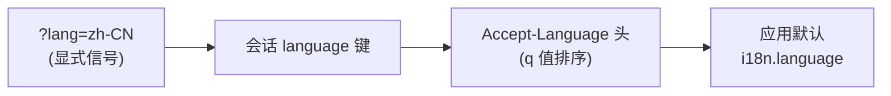

# 组件：i18n

消息翻译（JSON 文件 + go:embed）、语言协商链（参数 > 会话 > Accept-Language > 默认）、x/text 格式化（日期/数字/货币）。对应 `yii\i18n`。

## 消息文件与接入

`messages/<lang>/<category>.json`，消息 ID 即源语言（en-US）原文：

```json
// messages/zh-CN/app.json
{
  "Hello, {name}!": "你好，{name}！",
  "You have {n} new message.": { "one": "您有 {n} 条新消息。", "other": "您有 {n} 条新消息。" }
}
```

```go
//go:embed messages
var messages embed.FS

app.SetI18n(i18n.NewMessageSource(messages))   // 单二进制携带全部语言
// 未 embed 的场景：i18n.NewMessageSource(os.DirFS("messages"))
```

## 翻译与格式化

```go
msg := i18n.T(ctx, "app", "Hello, {name}!", map[string]any{"name": "Ada"})
// -> "Hello, Ada!" / "你好，Ada！"（按请求语言）

f := i18n.F(ctx)
f.Number(1234.5)          // en: 1,234.5   de: 1.234,5
f.Currency("USD", 1234.5) // "$ 1,234.50"  zh-CN: "US$ 1,234.50"
f.Date(t) / f.DateShort(t) / f.DateLong(t) / f.Time(t) / f.DateTime(t)
```

- 查不到译文回消息 ID 原文；占位符 `{name}` 数字按语言本地化。
- 复数：值可为 `{"one":..., "other":...}` 形态，整数参数 `n` 按 CLDR 基数规则选形。
- 日期形态：六语言内置（en/zh/ja/ko/de/fr），其余回退英文。

## 语言协商链

`web.NewHandler` 默认安装 Language 中间件，优先序：



经参数显式切换的值写入会话——之后的请求（无参数）保持该语言。偏好映射到已有翻译目录：`zh-Hans-CN -> zh-CN`、`en-GB -> en-US`、无亲和回默认。单条目缺失沿父链降级（`zh-CN -> zh -> und`）。

页面语言切换器就是普通链接：`<a href="/posts?lang=zh-CN">中文</a>`。

## 验证消息翻译

[validators](组件-validators.md) 的 flatten 边界统一翻译：模型规则产出的消息即消息 ID，`messages/zh-CN/app.json` 翻译 `"title cannot be blank"` 即本地化全部 422 响应与表单回显。

## 相关文档

- [组件：validators](组件-validators.md)
- [配置参考](配置参考.md)（`i18n` 段）
