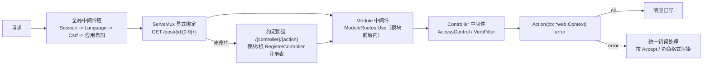

# 组件：web 路由与中间件

`web` 对应 `yii\web`：HTTP 入口 `Handler`、请求上下文 `Context`、Controller/Action 约定、显式路由 + 约定回退、Filter 族中间件、统一错误处理与反向 URL 生成。

## 请求管线



## Handler 与路由

```go
h := web.NewHandler(app)                    // 默认装 Session + Language + Csrf 中间件

h.Get("/post/{id:[0-9]+}", ctrl.ActionView).Name("post/view")
h.Post("/post", ctrl.ActionCreate).Name("post/create")

sc := h.Ctrl(ctrl)                          // 挂到控制器：动作自动包上控制器声明的中间件
sc.Get("/site/hello", ctrl.ActionHello).Name("site/hello")

url.SetDefault(h.URLs())                    // url.To 反向生成走这个路由表
```

- 通配符支持 ServeMux 全语法，外加约束形式 `{id:[0-9]+}`（框架在分发时校验）。
- 已显式绑定的路径收到未绑定动词 -> `405 + Allow`；其它未命中走约定回退（`web.DisableConventionFallback` 可关）。
- 命名路由供反向生成：`url.To("post/view", url.P{"id": 7})` -> `/post/7`；未命名的 route id 按 `/<name>` 约定拼装。

## 模块路由与模块级中间件

模块（[组件：base 与 config](组件-base与config.md)）经 `h.Module(prefix)` 取得挂载位，前缀逐级拼接、嵌套模块用全前缀取 registrar：

```go
admin, _ := base.NewModule(app, "/admin")
app.RegisterModule(admin)
report, _ := base.NewModule(app, "/admin/report")
admin.RegisterModule(report)             // 子模块挂在父模块下

ar, _ := h.Module("/admin")
ar.Use(web.AccessControl{Rules: [...]}.Middleware())   // 模块级中间件
ar.Get("/panel", ctrl.ActionPanel).Name("panel")        // 挂载 /admin/panel，名字 admin/panel

rr, _ := h.Module("/admin/report")       // 嵌套模块按全前缀取挂载位
rr.Get("dashboard", ctrl.ActionDash).Name("dashboard")  // /admin/report/dashboard，名字 admin/report/dashboard
```

- **模块级中间件**（`ModuleRoutes.Use`，对应 Yii2 module beforeAction）：作用于该模块前缀下的全部路由——显式挂载与约定回退一视同仁，嵌套子模块的路由也包在内（祖先模块的中间件在外层）。全局链 -> 模块中间件 -> 控制器中间件 -> Action。
- **命名路由自动带模块路径**：`Name` 传模块相对名，注册时自动拼上模块路径（`"dashboard"` -> `"admin/report/dashboard"`），`url.To` 反向生成直接命中；路径参数照常填充。
- **Layout 隔离**：子模块经自己的 registrar 设 `Layout` 即覆写父模块的框架，页面内 `ctx.SetLayout` 仍最高优先（见 [组件：view 与 templ](组件-view与templ.md)）。

## Context 与 Action

```go
type PostController struct{ web.Controller }   // 内嵌即成控制器，ActionXxx 方法可路由

func (c *PostController) ActionView(ctx *web.Context) error {
    id, err := ctx.ParamInt("id")              // 路径参数
    if err != nil { return web.NotFound("post not found") }
    post, err := ar.FindByID[Post](ctx.Context(), id)
    ...
    return ctx.JSON(post)                      // 或 ctx.Render / Redirect
}
```

`web.Context` 承载单请求的全部状态：`Request()/Response()`、`Param/ParamInt/ParamInt64`、`JSON/JSONStatus/Redirect`、`Render/RenderStatus`（templ 页面，见 [组件：view 与 templ](组件-view与templ.md)）、`CsrfToken()`、`Session()`、`User()`、`App()`、`ResponseFormat()`（协商出的格式）。action 返回 error 即交给统一错误处理。

## 中间件（Filter 族）

全局链经 `h.Use(...)` 追加；模块级经 `ModuleRoutes.Use(...)` 包住该模块前缀下的全部路由；单控制器经实现 `Middleware() []web.Middleware` 只包自己的动作：

| 中间件 | 用途 | 要点 |
|---|---|---|
| `web.AccessControl` | 角色授权 | 规则序评估，首条命中即决；`?`=guest、`@`=登录、其余为 RBAC 项（接 AuthManager 后端）；默认拒 |
| `web.VerbFilter` | 动词限制 | 命中规则外的动词 `405 + Allow` |
| `web.ContentNegotiator` | 内容协商 | 响应按 Accept 选格式，请求体 Content-Type 白名单（415） |
| `web.Csrf` | 双提交 cookie | 安全请求种 `_csrf` cookie；写请求须回同值（头 `X-Csrf-Token` 或表单字段 `_csrf`）；`web.disableCsrf` 可全局关 |
| `web.Cors` | 跨域 | 预检与常规 CORS 头 |
| `web.HttpCache` | 协商缓存 | ETag / Last-Modified |
| `web.PageCache` | 整页缓存 | 命中直接回放 200 的 GET 文本页（body + status + Content-Type）；key = 路由 + 规范化查询串 + `VaryBy` 值；`Duration` 生命周期、`cache.Dependency` 依赖失效；存储走 `app.Cache()` 组件 |
| `web.RateLimiter` | 限流 | 按键限速 |
| `web.HttpBasic` / `web.HttpBearer` | 无状态认证 | 解出瞬态 Identity（不落会话） |

### 整页缓存 PageCache

```go
func (c *PageController) Middleware() []web.Middleware {
    return []web.Middleware{
        web.PageCache{
            Duration:   3 * time.Second,                    // 生命周期（ttl）；省略走后端默认
            Dependency: cache.NewValueDependency(maxID()),   // 可选：数据变了条目作废
            VaryBy:     func(r *http.Request) string { ... }, // 可选：按请求分变体（用户/语言）
        }.Middleware(),
    }
}
```

只有 **200 的 GET 文本响应**参与：首次请求渲染动作并捕获响应（status + Content-Type + body）写入 `app.Cache()` 组件；后续 GET 直接回放缓存的整页，动作不再运行。POST 等写动词、非 200、JSON/二进制（无显式 Content-Type）、流式响应一律透传不缓存——回放的页面永远不会答一个变更请求。缓存 key = 路由路径 + 规范化查询串（参数排序，`?a=1&b=2` 与 `?b=2&a=1` 同一条目）+ `VaryBy` 值。

与 [调试面板](组件-debug面板.md) 共存时的层级：采集中间件在外、PageCache 在内——缓存条目保持干净（不烧进 toolbar），每次回放请求拿到当次的新 toolbar。完整可跑示例见 `examples/basic` 的 `/pagecache` 页（`CacheController`）。

```go
func (pc *PostController) Middleware() []web.Middleware {
    return []web.Middleware{
        web.AccessControl{Auth: pc.Auth, Rules: []web.AccessRule{
            {Allow: true, Roles: []string{"?", "@"}, Verbs: []string{http.MethodGet}},
            {Allow: true, Roles: []string{"post/delete"}, Verbs: []string{http.MethodDelete}},
        }}.Middleware(),
    }
}
```

## 统一错误处理

HTTP 语义错误用构造函数表达，action 直接返回：

```go
return web.NotFound("post not found")      // 404
return web.BadRequest("malformed body")    // 400
return web.Unauthorized("...")             // 401
return web.Forbidden("...")                // 403
return web.ServerError("...")              // 500
```

渲染格式跟随协商：JSON 客户端得到 `{"name":"Not Found","message":...,"status":404}`，HTML 得到错误页（可在视图注册表用保留名 `error/<status>`、`error` 覆盖）。action panic 被恢复为 500 并记日志。

## 反向 URL 生成

```go
url.To("post/view", url.P{"id": strconv.FormatInt(post.ID, 10)})  // -> /post/26
url.To("post/index", url.P{"page": "2", "sort": "-id"})           // 冗余参数成查询串
```

生成失败（命名路由缺路径参数）返回 `"#"`，与 Yii2 的 cannot-create 标记一致。

## 相关文档

- [组件：session 与认证](组件-session与认证.md)
- [组件：rbac](组件-rbac.md)
- [组件：view 与 templ](组件-view与templ.md)
