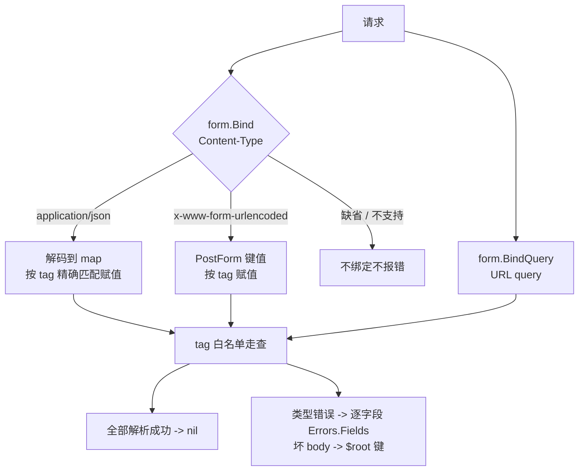

# 组件：表单模型（form）

带 `form` 标签的普通 struct 即「表单模型」（术语见 CONTEXT.md）：框架一次完成请求绑定与按场景校验，**标签即赋值白名单**，未打标签的字段不参与绑定。它取代 Yii2 的 `Model.load()` 大规模赋值——没有动态属性、没有第二套基类，校验复用 [validators](组件-validators.md) 的场景机制，错误形态就是统一的 `字段 -> []消息`。

```go
type LoginForm struct {
    Username string `form:"username"`
    Password string `form:"password"`
}
```

## 绑定白名单与支持类型

**`form` 标签即白名单**：只有打了 `form:"name"` 的导出字段会被赋值；未打标签的字段无论请求怎么构造都保持原值，`form:"-"` 显式退出；请求里没有对应字段的键（`_csrf` 等隐藏字段）静默忽略——over-posting（提交 `isAdmin`、`price` 这类 action 没打算改的字段）没有入口。

支持的字段类型：

| 类型 | 说明 |
|---|---|
| `string` / 各定长整型 / `float32,64` / `bool` | 标量全集 |
| `[]string` | 多值字段（表单多选、JSON 数组） |
| `time.Time` | RFC 3339 线上格式（`2026-01-02T15:04:05Z`，含小数秒） |
| `encoding.TextUnmarshaler` | 自定义类型自带解析（`UnmarshalText` 收值） |
| 以上各类型的指针（`*string`、`*time.Time`…） | 可空列的天然形态：来值才分配 pointee |

空值语义统一为**「未填写」**：`age=`、JSON 的 `""` / `null` 对非文本字段不赋值不报错（指针字段保持现值，NULL 不翻转）；文本字段取空串。字段可否为空由 validators 的规则裁决，绑定层不越权。打了标签但类型不支持的字段收到值会 panic——编程错误尽早炸。

## 三源绑定

```go
errs := form.Bind(r, &f)        // body：按 Content-Type 分发
//   application/json          -> JSON 源
//   x-www-form-urlencoded     -> 表单源
//   缺省 / 其它类型           -> 不绑定不报错（未声明 body 源）

errs := form.BindQuery(r, &f)   // URL query（唯一来源）
```

三源严格分源：表单 body 读不到 query 参数，query 绑定看不到 body 值。空 body / 空 query / `{}` 是合法空提交——模型保持现值，不报错。三源走**同一份白名单走查代码**，语义由结构保证一致：



**JSON 源不走 `encoding/json` 直解 struct**：body 先解码到 `map[string]any` 再按 tag 赋值。`encoding/json` 的大小写不敏感字段匹配（键 `AuthorID` / `author_id` 都能命中同名字段）正是直绑记录时越权赋值的入口，map 中转让键只有精确命中 tag 才赋值。类型不匹配逐字段报错（字符串给 int 字段报该字段自身的消息），同 body 内其余字段照常绑定；截断 / 非对象 / 整包 `null` 的坏 body 归并到记录级 `$root` 键。消息走 i18n（`validators.MessageCategory` 类别，与规则消息同路径）。

## Load 闭环：绑定 + 校验一步

`form.Load(ctx, r, &f, scenario)` = 绑定 + 按场景校验，两阶段错误合并为一个 `*validators.Errors`（nil = 通过）。action 里用 `web.Context` 的薄委托 `c.LoadForm`：

- 模型实现了 `validators.Ruled` 才校验，普通 struct 仅绑定；
- 校验面对绑定后的模型：同一字段内**解析错误在前、规则错误在后**，顺序固定；
- 解析失败不挡校验——绑定保零值的字段照走规则（`Required` 前缀规则链即在此触发）。

登录表单是「非落库表单走闭环」的正统形态（示例取自 examples/basic）：

```go
type loginForm struct {
    Username string `form:"username"`
    Password string `form:"password"`
}

const scenarioLogin validators.Scenario = "login"

func (f *loginForm) Rules() validators.RuleSet {
    return validators.RuleSet{
        scenarioLogin: z.Struct(z.Shape{
            "username": z.String().Required(z.Message("username cannot be blank")),
            "password": z.String().Required(z.Message("password cannot be blank")),
        }),
    }
}

func (site *SiteController) ActionLogin(c *web.Context) error {
    var f loginForm
    if errs := c.LoadForm(&f, scenarioLogin); errs != nil {
        return c.JSONStatus(http.StatusUnprocessableEntity, errs.Fields) // 422 扁平错误
    }
    // ... authenticate ...
}
```

> zog 陷阱：zog 原生类型默认可选，零值字段不触发无 `Required` 前缀的规则链——要在空提交时拿到可断言的字段消息，规则链需 `Required(z.Message(...))` 前缀。

## 直绑记录：create 直绑、update 先查再绑

落库表单不需要中间层——**模型上的 `form` 标签即契约**，JSON 与 HTML 双路径共用。模型侧只给可编辑列打标签，主键、引用列、行为字段交给服务端：

```go
// models/post.go：可编辑列打 form 标签；ID、AuthorID、Author 与
// Timestamp 行为字段无标签——只由服务端代码赋值
type Post struct {
    ar.Model
    ID       int64  `gorm:"column:id;primaryKey" json:"id"`
    Title    string `gorm:"column:title" form:"title" json:"title"`
    Body     string `gorm:"column:body" form:"body" json:"body"`
    Status   string `gorm:"column:status" form:"status" json:"status"`
    AuthorID int64  `gorm:"column:author_id" json:"author_id"`
    Author   *User  `gorm:"foreignKey:AuthorID" json:"author,omitempty"`
    behaviors.Hooks
    behaviors.Timestamp
}
```

```go
// create：直绑零值记录，insert 场景；服务端补值字段在 Load 之后赋值
post := ar.New[models.Post](c.Context()).New()
if errs := c.LoadForm(post, validators.ScenarioInsert); errs != nil {
    return c.JSONStatus(http.StatusUnprocessableEntity, errs.Fields)
}
post.AuthorID = author.ID          // 提交永远携带不上
if err := post.Save(); err != nil { /* errors.As 取 *validators.Errors */ }

// update：先查再绑——fetch -> Load -> Save，
// 未提交字段保留库值，不被零值覆盖
post, err := ar.FindByID[models.Post](c.Context(), id)   // 404 语义不变
if errs := c.LoadForm(post, validators.ScenarioUpdate); errs != nil {
    return c.JSONStatus(http.StatusUnprocessableEntity, errs.Fields)
}
if err := post.Save(); err != nil { /* ... */ }
```

先查再绑是 update 的固定形态：表单没带的字段保持库值（编辑表单少提交一个 `body`，库里原值保留），而不是被零值冲掉。

## 列表过滤：filter struct + Apply

列表过滤不引入 SearchModel——**读取机制归框架、查询语义留项目**：filter struct 打 `form` 标签经 `form.BindQuery` 读 query，`Apply` 显式组装 SQL（示例取自 examples/basic）：

```go
type postFilters struct {
    Title  string `form:"title"`
    Status string `form:"status"`
}

func (f postFilters) apply(query *ar.Query[models.Post]) *ar.Query[models.Post] {
    if f.Title != "" {
        query = query.Where("title LIKE ?"+likeEscapeClause, likePattern(f.Title)) // LIKE 全转义
    }
    if f.Status != "" {
        query = query.Where("status = ?", f.Status)
    }
    return query
}

// ActionList 内：
var filters postFilters
if errs := form.BindQuery(c.Request(), &filters); errs != nil {
    return web.BadRequest(errs.Error())   // 全文本字段时不会触发；防未来非文本过滤字段静默丢坏值
}
filters.Title = strings.TrimSpace(filters.Title)

res, err := dataprovider.ActiveDataProvider[models.Post]{
    Query:  filters.apply(ar.New[models.Post](c.Context()).With("Author")),
    Params: params,                        // dataprovider.FromRequest 照旧——排序白名单属取数层
    DefaultOrder: []dataprovider.Sort{{Column: "id", Desc: true}},
}.Prepare()
```

分页 / 排序链接保留过滤值的 keep 闭包由 `form.Values` 派生，不逐字段手抄键名——新增过滤字段零改动自动携带：

```go
filterValues := form.Values(&filters)
keep := func(p url.P) url.P {
    for name, value := range filterValues {
        if value != "" {
            p[name] = value
        }
    }
    return p
}
```

[GridView](组件-view与templ.md) 的过滤行只渲染输入与回显，查询组装归 action（见 ADR-0006）；`dataprovider.FromRequest` 的分页排序解析与字段绑定是两层，并存不合并。

## form.Values 回填

`form.Values(f)` 把模型导出成 ActiveForm 的回填 map（`map[string]string`，按 tag 取键）：字符串原样、数值最短精确表示、bool `true`/`false`、`[]string` 逗号连接（nil/空渲染 `""`）、`time.Time` 渲染 RFC 3339（小数秒保留，编辑表单回填再提交不丢精度）、nil 指针渲染空串（NULL 列输入显示为空）。无文本形态的字段（只有 `UnmarshalText` 没有 `MarshalText`）不入结果。

```go
// 新表单：零值记录出回填（status select 默认选中 draft）
post := ar.New[models.Post](c.Context()).New()
post.Status = models.PostStatusDraft
return renderPostForm(c, false, http.StatusOK, form.Values(post), nil)

// 被拒提交：422 重渲染，回显模型已绑定的值 + 逐字段错误
if errs := c.LoadForm(post, validators.ScenarioInsert); errs != nil {
    return replayPostForm(c, false, form.Values(post), errs)
}
```

`renderPostForm` 把 map 交给 ActiveForm，后者渲染标签、控件与失败字段下的错误：

```go
form := view.ActiveForm{
    ID: "post-form", Action: action,
    Fields: []view.ActiveField{
        {Name: "title", Label: t("Title"), Type: view.FieldText, Required: true, MaxLength: 200},
        {Name: "status", Label: t("Status"), Type: view.FieldSelect, Options: []view.FieldOption{ /* ... */ }},
        {Name: "body", Label: t("Body"), Type: view.FieldTextarea},
    },
    Errors: verrs,          // *validators.Errors：直接来自 Load/Save 链
    Values: values,         // form.Values(...) 的回填 map
    CSRF:   c.CsrfToken(),
}
```

注意：HTML checkbox 无法区分「未勾选」与「省略」，未勾选提交不置 `false`——需要显式 false 语义时自行加哨兵字段。

## gii 生成物形态

[gii](组件-gii代码生成器.md) 的 model 命令给可编辑列生成 `form` 标签（主键、`..._id` 引用列、二进制列、`created_at`/`updated_at` 不打标签）；crud 命令生成与上文的直绑 / 过滤骨架同形态：create 直绑零值记录、update 先查再绑、filter struct + `BindQuery` + `Apply`（LIKE 转义辅助随生成物自带）+ `keep` 派生、ActiveForm 回填经 `form.Values`。datetime 列渲染为带 RFC 3339 占位符的 text 输入——绑定层的日期时间线上格式是 RFC 3339，`datetime-local` 控件提交不了。

## 逃生门：直接用 zog

框架不禁止绕开表单模型直接用 zog——`validators` 的 zog 底座原样可用，这是逃生门（能力仍在），但示例与生成物不再演示旁路写法：错误形态统一经 `validators.Errors`、翻译统一走其 i18n 路径，第二套错误出口（裸 `z.Issues` + 手工翻译）没有理由再出现。直接用 zog 的场合，自行负责错误形态与翻译的对接。

## 相关文档

- [组件：validators](组件-validators.md)（场景规则、错误形态、消息翻译）
- [组件：web 路由与中间件](组件-web路由与中间件.md)（`web.Context` 与 action）
- [组件：view 与 templ](组件-view与templ.md)（ActiveForm / GridView 回填与过滤行）
- [组件：dataprovider](组件-dataprovider.md)（分页排序与 FromRequest 白名单）
- [组件：gii 代码生成器](组件-gii代码生成器.md)（生成物中的表单模型形态）
