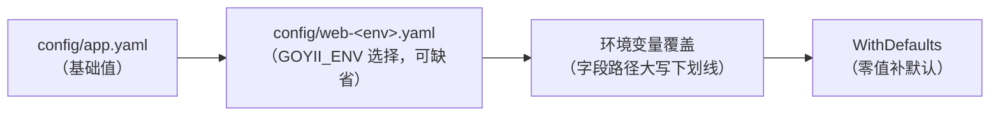

# 配置参考

框架配置是纯值轨（行为在代码里装配）：`config/app.yaml` + `config/web-<env>.yaml` 覆盖层 + 环境变量覆盖。本文汇总全部段落、字段、默认值与对应环境变量。

## 加载规则

- `GOYII_ENV`（默认 `dev`）决定覆盖层文件名；文件不存在即跳过。
- 环境变量名 = yaml 字段路径全大写下划线：`DB_DSN`、`WEB_LISTEN`、`REDIS_ADDR`、`CACHE_REDIS_ADDR`、`MAIL_SMTP_ENCRYPTION`...
- `config.Load("config")` 返回补全默认后的 `config.Config`；程序内改行为用代码，不改配置结构。

## app — 应用标识

| 字段 | 默认 | 环境变量 | 说明 |
|---|---|---|---|
| `name` | `myapp` | `APP_NAME` | 应用名（布局、邮件缺省等） |
| `language` | `en-US` | `APP_LANGUAGE` | 源语言：消息 ID 的书写语言 |
| `timezone` | `UTC` | `APP_TIMEZONE` | IANA 时区名 |
| `debug` | `false` | `APP_DEBUG` | 调试态标记（应用自行消费） |

顶层 `env`（`GOYII_ENV`）是装载器写入的环境名，只读。

## web — HTTP 服务

| 字段 | 默认 | 环境变量 | 说明 |
|---|---|---|---|
| `listen` | `:8080` | `WEB_LISTEN` | 监听地址 host:port |
| `disableConventionFallback` | `false` | `WEB_DISABLECONVENTIONFALLBACK` | 关闭 `/{controller}/{action}` 约定回退（全显式绑定时） |
| `disableCsrf` | `false` | `WEB_DISABLECSRF` | 全局关闭 CSRF 中间件（纯 API、每请求自带认证时） |

## db — 数据库

| 字段 | 默认 | 环境变量 | 说明 |
|---|---|---|---|
| `driver` | — | `DB_DRIVER` | `sqlite` / `mysql` / `postgres` / `sqlserver`（别名 sqlite3/postgresql/mssql） |
| `dsn` | — | `DB_DSN` | 驱动各自格式；migrate 命令同样从这里取（兼容 DB_DSN 环境变量） |

## redis — 共享连接

顶层可选段，喂给 Application 的共享 redis 连接：cache / session 的 redis 后端（及后续 mutex / queue）默认共用这一条连接。不配置且无组件用时零开销。

| 字段 | 默认 | 环境变量 | 说明 |
|---|---|---|---|
| `addr` | — | `REDIS_ADDR` | redis 服务器地址 host:port |
| `password` | — | `REDIS_PASSWORD` | |
| `db` | `0` | `REDIS_DB` | 逻辑库编号 |

cache / session 各自的 `redis:` 子段降级为**可选覆盖**：空则继承顶层共享连接，非空则以本段值另开一条专用连接（指向别的服务器时无法共享）。

## cache — 缓存

| 字段 | 默认 | 环境变量 | 说明 |
|---|---|---|---|
| `driver` | `memory` | `CACHE_DRIVER` | `memory` / `file` / `redis` |
| `keyPrefix` | — | `CACHE_KEYPREFIX` | file/redis 键命名空间（Flush 只清本前缀） |
| `ttl` | `3600` | `CACHE_TTL` | 秒；调用传 `ttl <= 0` 时的默认寿命 |
| `path` | 系统临时目录 | `CACHE_PATH` | file 后端目录 |
| `redis.addr` | — | `CACHE_REDIS_ADDR` | 覆盖段：非空则不走共享连接 |
| `redis.password` | — | `CACHE_REDIS_PASSWORD` | |
| `redis.db` | `0` | `CACHE_REDIS_DB` | 逻辑库编号 |

## mutex — 互斥锁

| 字段 | 默认 | 环境变量 | 说明 |
|---|---|---|---|
| `driver` | `process` | `MUTEX_DRIVER` | `process`（进程内按名锁）/ `redis`（跨进程，用顶层共享 redis 连接） |

锁语义见 [组件：base 与 config](组件-base与config.md)：不可重入，`ttl` 到期自动放、不自动续期，长持锁由调用方分段重取。

## queue — 异步队列

| 字段 | 默认 | 环境变量 | 说明 |
|---|---|---|---|
| `driver` | `sync` | `QUEUE_DRIVER` | `sync`（即推即执行，开发/测试）/ `db`（建表存消息，零外部服务）/ `redis`（跨进程，用顶层共享 redis 连接） |
| `tableName` | `queue` | `QUEUE_TABLENAME` | db 驱动的队列表名；用 `queue.NewMigration(cfg.Queue.TableName)` 建表 |
| `pollIntervalMs` | `1000` | `QUEUE_POLLINTERVALMS` | listen 常驻 worker 空闲时的轮询间隔（测试可调短） |

队列语义见 [组件：base 与 config](组件-base与config.md)：Job 注册名 + JSON 载荷、Attempts/TTR/退避重试、failed 保留与 `queue/retry` 重推。

## log — 日志

| 字段 | 默认 | 环境变量 | 说明 |
|---|---|---|---|
| `level` | `info` | `LOG_LEVEL` | 根级别：`debug`/`info`/`warn`/`error` |
| `gorm.disable` | `false` | — | 关掉 GORM 查询日志适配器 |
| `gorm.slowThresholdMs` | `200` | — | 慢查询阈值（毫秒，达阈值记 WARN） |

`log.targets[]`（多 Target 依次登记）：

| 字段 | 说明 |
|---|---|
| `type` | `console` / `file` |
| `minLevel` | 该 Target 的级别下限（只能比根级别更严） |
| `categories` | 类别包含模式（`db`、`db*`、`*`；空 = 全部） |
| `except` | 类别排除模式，优先于 categories |
| `path` | file：日志文件路径 |
| `maxSizeMB` | file：超此大小轮转 |
| `maxFiles` | file：保留的轮转份数 |

## session — 会话

| 字段 | 默认 | 环境变量 | 说明 |
|---|---|---|---|
| `name` | `goyii-session` | `SESSION_NAME` | 会话 cookie 名 |
| `backend` | `file` | `SESSION_BACKEND` | `file` / `redis` |
| `path` | 系统临时目录 | `SESSION_PATH` | file 后端目录 |
| `timeout` | `1440` | `SESSION_TIMEOUT` | 秒 |
| `redis.*` | — | `SESSION_REDIS_*` | 覆盖段：同 cache 的 redis 子段，非空则不走共享连接 |

## i18n — 国际化

| 字段 | 默认 | 环境变量 | 说明 |
|---|---|---|---|
| `language` | 空（回退源语言） | `I18N_LANGUAGE` | 无偏好请求的显示语言 |
| `messagesDir` | `messages` | `I18N_MESSAGESDIR` | 磁盘消息目录；embed 应用忽略此值（`app.SetI18n` 直接装 embed.FS） |

## mail — 邮件

| 字段 | 默认 | 环境变量 | 说明 |
|---|---|---|---|
| `driver` | `log` | `MAIL_DRIVER` | `log`（记录到应用日志）/ `smtp` |
| `from` | — | `MAIL_FROM` | 缺省发件人（`Name <addr>` 或裸地址） |
| `smtp.host` | — | `MAIL_SMTP_HOST` | |
| `smtp.port` | `587`（smtps 时 `465`） | `MAIL_SMTP_PORT` | |
| `smtp.username` | — | `MAIL_SMTP_USERNAME` | 非空启用 AUTH PLAIN |
| `smtp.password` | — | `MAIL_SMTP_PASSWORD` | |
| `smtp.encryption` | `starttls` | `MAIL_SMTP_ENCRYPTION` | `none` / `starttls` / `smtps`（别名 `tls`/`ssl`） |

## 完整示例

见 `examples/basic/config/app.yaml`——全部段落各取一态的实战配置（SQLite、file 缓存/会话、双 Target 日志、i18n、log 邮件）。

## 相关文档

- [组件：base 与 config](组件-base与config.md)
- [安装](安装.md)
